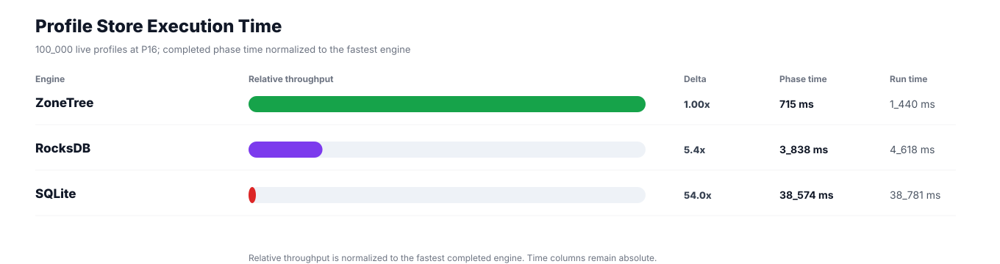
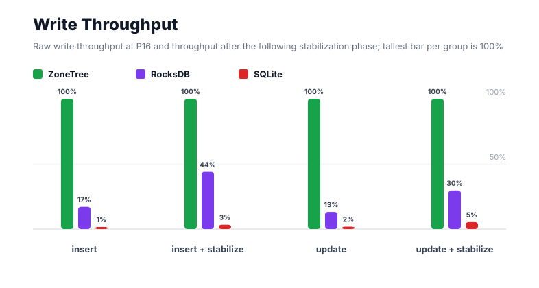
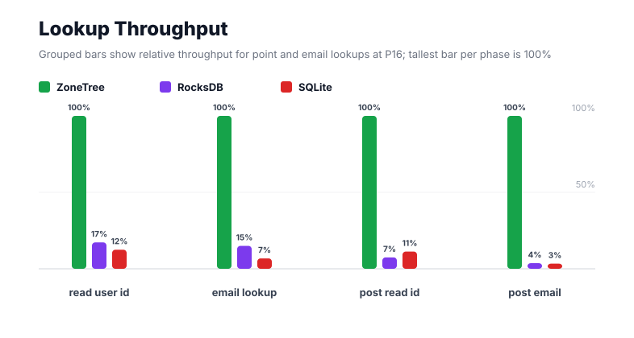
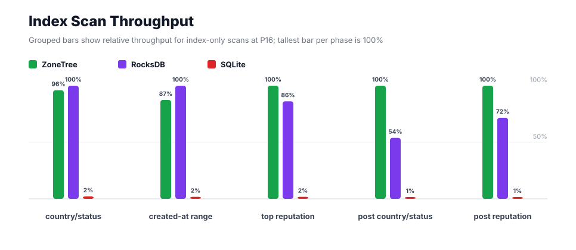
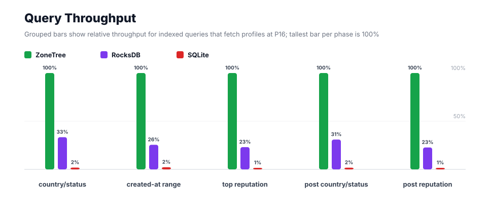
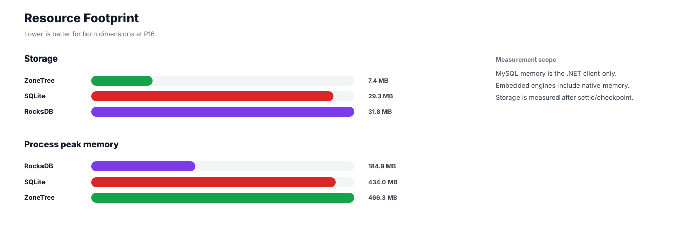

# Benchmark 100K Profiles / P16 - Windows

## Charts

### Execution Time

### Write Throughput

### Lookup Throughput

### Index Scan Throughput

### Query Throughput

### Resource Footprint

## Total By Engine

| Engine | Status | Run time | Completed phase time | Pre-read stabilize | Post-update stabilize | Settle | Reopen | Verify | Storage | Process peak memory | Final checksum |
| --- | --- | ---: | ---: | ---: | ---: | ---: | ---: | ---: | ---: | ---: | --- |
| ZoneTree | Completed | 1_440 ms | 715 ms | 225 ms | 200 ms | 16 ms | 69 ms | 11 ms | 7.4 MB | 466.3 MB | `1C7232F217FD84C5` |
| RocksDB | Completed | 4_618 ms | 3_838 ms | 192 ms | 242 ms | 1 ms | 46 ms | 18 ms | 31.8 MB | 184.9 MB | `1C7232F217FD84C5` |
| SQLite | Completed | 38_781 ms | 38_574 ms | n/a | n/a | 95 ms | 1 ms | 5 ms | 29.3 MB | 434.0 MB | `1C7232F217FD84C5` |

## Correctness

Checksum validation passed across completed engines: ZoneTree, RocksDB, SQLite.

## Interpretation Notes

* This benchmark measures live single-operation profile inserts, updates, reads, and indexed queries.
* ZoneTree and RocksDB secondary indexes are maintained by the benchmark application using separate stores.
* SQLite maintains secondary indexes inside the database engine.
* Embedded engines run in the benchmark process.
* Completed phase time is the sum of measured workload phases. Run time also includes initialization, stabilization, settle/checkpoint, reopen, verification, and reporting overhead.
* The write throughput chart includes raw write phases and derived write-readiness bars that add the following stabilization phase.
* Storage is measured after each engine settles or checkpoints its data.
* Process peak memory is measured for the benchmark process.

## Write Readiness

| Engine | Insert | Pre-read stabilize | Insert + stabilize | Insert ready throughput | Update | Post-update stabilize | Update + stabilize | Update ready throughput |
| --- | ---: | ---: | ---: | ---: | ---: | ---: | ---: | ---: |
| ZoneTree | 89 ms | 225 ms | 314 ms | 318_526/s | 103 ms | 200 ms | 303 ms | 330_030/s |
| RocksDB | 523 ms | 192 ms | 715 ms | 139_798/s | 782 ms | 242 ms | 1_024 ms | 97_642/s |
| SQLite | 9_471 ms | n/a | 9_471 ms | 10_559/s | 5_674 ms | n/a | 5_674 ms | 17_624/s |

## Phase Results

### ZoneTree

| Phase | Operations | Time | Throughput | Checksum |
| --- | ---: | ---: | ---: | --- |
| insert profiles | 100_000 | 89 ms | 1_123_583/s | `97D1578AB310103B` |
| read by user id | 100_000 | 63 ms | 1_580_635/s | `A8C120E850D25A96` |
| lookup by email | 100_000 | 51 ms | 1_969_427/s | `80AF4F910EF0BB82` |
| scan country/status index | 25_000 | 30 ms | 835_391/s | `4B8B9AF04E34827B` |
| query country/status | 25_000 | 61 ms | 406_872/s | `1DBF6AA59C11B6CE` |
| scan created-at index | 25_000 | 27 ms | 924_734/s | `6ADAA8B323030955` |
| query created-at range | 25_000 | 73 ms | 343_415/s | `84DB32B4F7F819D7` |
| scan top reputation index | 25_000 | 17 ms | 1_455_257/s | `B4B15C95B8B7F255` |
| query top reputation | 25_000 | 40 ms | 632_431/s | `033096858774A1D5` |
| update profiles | 100_000 | 103 ms | 974_203/s | `B89210BB6E1F6BF1` |
| post-update read by user id | 100_000 | 28 ms | 3_571_709/s | `E193CDCF8B07F585` |
| post-update lookup by email | 100_000 | 13 ms | 7_890_854/s | `10AA7E4F49CB88ED` |
| post-update scan country/status index | 25_000 | 12 ms | 2_072_419/s | `8F87368BDEB6B94D` |
| post-update query country/status | 25_000 | 57 ms | 438_405/s | `380F06B898A0BD21` |
| post-update scan top reputation index | 25_000 | 13 ms | 1_921_156/s | `5B74798E2A24B945` |
| post-update query top reputation | 25_000 | 38 ms | 649_947/s | `66D86EA0F1F31EA5` |

### RocksDB

| Phase | Operations | Time | Throughput | Checksum |
| --- | ---: | ---: | ---: | --- |
| insert profiles | 100_000 | 523 ms | 191_074/s | `97D1578AB310103B` |
| read by user id | 100_000 | 367 ms | 272_732/s | `A8C120E850D25A96` |
| lookup by email | 100_000 | 339 ms | 295_201/s | `80AF4F910EF0BB82` |
| scan country/status index | 25_000 | 29 ms | 869_962/s | `4B8B9AF04E34827B` |
| query country/status | 25_000 | 184 ms | 135_871/s | `1DBF6AA59C11B6CE` |
| scan created-at index | 25_000 | 24 ms | 1_058_398/s | `6ADAA8B323030955` |
| query created-at range | 25_000 | 285 ms | 87_593/s | `84DB32B4F7F819D7` |
| scan top reputation index | 25_000 | 20 ms | 1_254_088/s | `B4B15C95B8B7F255` |
| query top reputation | 25_000 | 171 ms | 146_103/s | `033096858774A1D5` |
| update profiles | 100_000 | 782 ms | 127_822/s | `B89210BB6E1F6BF1` |
| post-update read by user id | 100_000 | 376 ms | 266_257/s | `E193CDCF8B07F585` |
| post-update lookup by email | 100_000 | 344 ms | 290_614/s | `10AA7E4F49CB88ED` |
| post-update scan country/status index | 25_000 | 22 ms | 1_115_847/s | `8F87368BDEB6B94D` |
| post-update query country/status | 25_000 | 184 ms | 135_602/s | `380F06B898A0BD21` |
| post-update scan top reputation index | 25_000 | 18 ms | 1_376_508/s | `5B74798E2A24B945` |
| post-update query top reputation | 25_000 | 169 ms | 147_692/s | `66D86EA0F1F31EA5` |

### SQLite

| Phase | Operations | Time | Throughput | Checksum |
| --- | ---: | ---: | ---: | --- |
| insert profiles | 100_000 | 9_471 ms | 10_559/s | `97D1578AB310103B` |
| read by user id | 100_000 | 508 ms | 197_009/s | `A8C120E850D25A96` |
| lookup by email | 100_000 | 749 ms | 133_568/s | `80AF4F910EF0BB82` |
| scan country/status index | 25_000 | 1_368 ms | 18_269/s | `4B8B9AF04E34827B` |
| query country/status | 25_000 | 3_310 ms | 7_552/s | `1DBF6AA59C11B6CE` |
| scan created-at index | 25_000 | 1_352 ms | 18_486/s | `6ADAA8B323030955` |
| query created-at range | 25_000 | 3_259 ms | 7_670/s | `84DB32B4F7F819D7` |
| scan top reputation index | 25_000 | 975 ms | 25_648/s | `B4B15C95B8B7F255` |
| query top reputation | 25_000 | 2_787 ms | 8_972/s | `033096858774A1D5` |
| update profiles | 100_000 | 5_674 ms | 17_624/s | `B89210BB6E1F6BF1` |
| post-update read by user id | 100_000 | 249 ms | 402_215/s | `E193CDCF8B07F585` |
| post-update lookup by email | 100_000 | 376 ms | 265_635/s | `10AA7E4F49CB88ED` |
| post-update scan country/status index | 25_000 | 1_330 ms | 18_802/s | `8F87368BDEB6B94D` |
| post-update query country/status | 25_000 | 3_225 ms | 7_751/s | `380F06B898A0BD21` |
| post-update scan top reputation index | 25_000 | 1_019 ms | 24_527/s | `5B74798E2A24B945` |
| post-update query top reputation | 25_000 | 2_922 ms | 8_557/s | `66D86EA0F1F31EA5` |

## Configuration

* Profiles: 100_000
* Parallelism: 16
* Profile writes: individual operations
* UserId reads: 100_000
* Email lookups: 100_000
* Query count: 25_000
* Profile updates: 100_000
* Post-update UserId reads: 100_000
* Post-update email lookups: 100_000
* Post-update query count: 25_000
* Query limit: 50
* Seed: 570123434
* Timeout: disabled

## Environment

* OS: Microsoft Windows 10.0.26200
* Architecture: X64
* .NET: 10.0.6
* CPU: Intel(R) Core(TM) Ultra 7 265KF
* Logical processors: 20
* Total available memory: 63.6 GB
* Initial process working set: 55.9 MB
* Benchmark version: 1.0.0.0
* ZoneTree version: 2.0.4.0
* Microsoft.Data.Sqlite version: 10.0.0
* SQLite runtime version: 3.50.3
* SQLitePCLRaw.core version: 2.1.11
* SQLitePCLRaw.lib.e_sqlite3 version: 3.50.3
* RocksDbSharp version: 6.2.2
* RocksDbNative version: 6.2.2
* MySqlConnector version: 2.4.0

## Engine Settings

### ZoneTree

* MutableSegmentMaxItemCount: 250000
* SparseArrayStepSize: 16
* KeyCacheSize: 1024
* ValueCacheSize: 1024
* IteratorPrefetchSize: 16
* BlockCacheLifeTime: 1 minutes
* BottomMergePolicy: Full bottom merge when bottom segment count exceeds 1
* ReadStabilization: Settle before read/query phases

### RocksDB

* Databases: profiles,email-index,country-status-index,created-at-index,reputation-index
* Compression: Zstd
* WriteBufferMb: 1024
* MaxWriteBufferNumber: 4
* WriteSync: false
* ReadStabilization: Compact before read/query phases

### SQLite

* JournalMode: WAL
* Synchronous: NORMAL
* CacheMb: 1024
* MmapMb: 1024
* TempStore: MEMORY

## Durability Settings

* ZoneTree: AsyncCompressed WAL default; MutableSegmentMaxItemCount=250000; SparseArrayStepSize=16; KeyCacheSize=1024; ValueCacheSize=1024; IteratorPrefetchSize=16; BlockCacheLifeTime=1 minutes; application-managed secondary indexes; background maintainers enabled.
* RocksDB: WAL enabled; five separate RocksDB instances; no WriteBatch across indexes; compression=Zstd; write_buffer_size=1024 MB per database; max_write_buffer_number=4.
* SQLite: WAL journal mode; synchronous=NORMAL; cache=1024 MB; mmap=1024 MB; native SQL indexes; single-row writes use autocommit.
