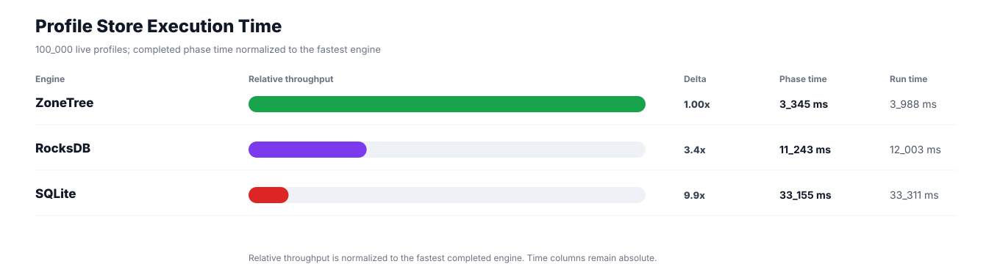
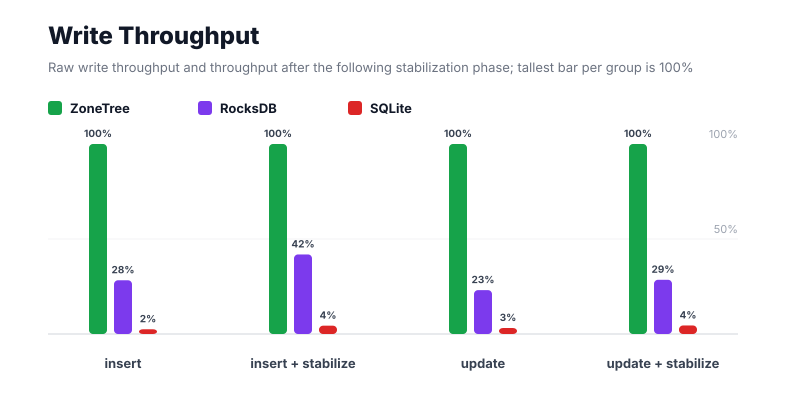
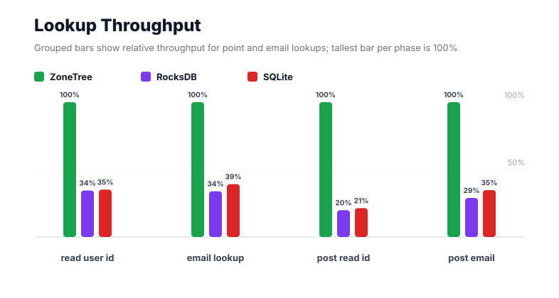
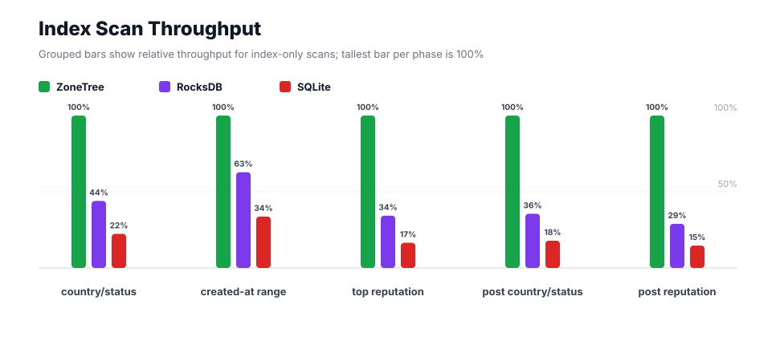
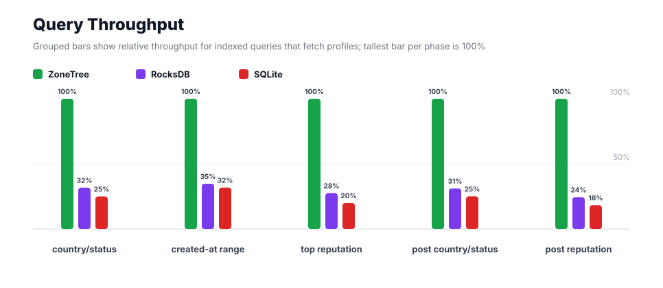
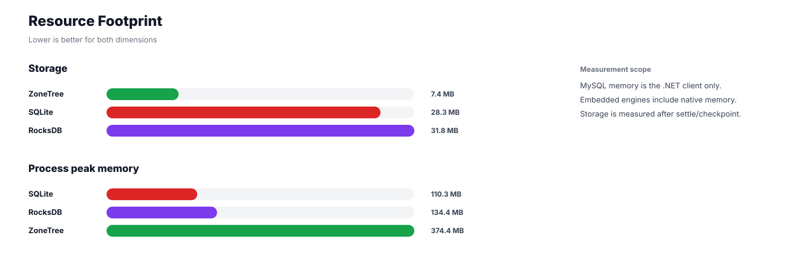

# Benchmark 100K Profiles - Windows

## Charts

### Execution Time

### Write Throughput

### Lookup Throughput

### Index Scan Throughput

### Query Throughput

### Resource Footprint

## Total By Engine

| Engine | Status | Run time | Completed phase time | Pre-read stabilize | Post-update stabilize | Settle | Reopen | Verify | Storage | Process peak memory | Final checksum |
| --- | --- | ---: | ---: | ---: | ---: | ---: | ---: | ---: | ---: | ---: | --- |
| ZoneTree | Completed | 3_988 ms | 3_345 ms | 200 ms | 152 ms | 13 ms | 75 ms | 11 ms | 7.4 MB | 374.4 MB | `1C7232F217FD84C5` |
| RocksDB | Completed | 12_003 ms | 11_243 ms | 172 ms | 235 ms | 1 ms | 43 ms | 19 ms | 31.8 MB | 134.4 MB | `1C7232F217FD84C5` |
| SQLite | Completed | 33_311 ms | 33_155 ms | n/a | n/a | 13 ms | 1 ms | 10 ms | 28.3 MB | 110.3 MB | `1C7232F217FD84C5` |

## Correctness

Checksum validation passed across completed engines: ZoneTree, RocksDB, SQLite.

## Interpretation Notes

* This benchmark measures live single-operation profile inserts, updates, reads, and indexed queries.
* ZoneTree and RocksDB secondary indexes are maintained by the benchmark application using separate stores.
* SQLite maintains secondary indexes inside the database engine.
* Embedded engines run in the benchmark process.
* Completed phase time is the sum of measured workload phases. Run time also includes initialization, stabilization, settle/checkpoint, reopen, verification, and reporting overhead.
* The write throughput chart includes raw write phases and derived write-readiness bars that add the following stabilization phase.
* Storage is measured after each engine settles or checkpoints its data.
* Process peak memory is measured for the benchmark process.

## Write Readiness

| Engine | Insert | Pre-read stabilize | Insert + stabilize | Insert ready throughput | Update | Post-update stabilize | Update + stabilize | Update ready throughput |
| --- | ---: | ---: | ---: | ---: | ---: | ---: | ---: | ---: |
| ZoneTree | 266 ms | 200 ms | 466 ms | 214_555/s | 362 ms | 152 ms | 514 ms | 194_650/s |
| RocksDB | 941 ms | 172 ms | 1_113 ms | 89_838/s | 1_566 ms | 235 ms | 1_801 ms | 55_539/s |
| SQLite | 10_667 ms | n/a | 10_667 ms | 9_374/s | 11_469 ms | n/a | 11_469 ms | 8_719/s |

## Phase Results

### ZoneTree

| Phase | Operations | Time | Throughput | Checksum |
| --- | ---: | ---: | ---: | --- |
| insert profiles | 100_000 | 266 ms | 375_891/s | `37C6E9056D5AC045` |
| read by user id | 100_000 | 98 ms | 1_019_066/s | `3C75C3A02940F75F` |
| lookup by email | 100_000 | 139 ms | 720_729/s | `8EACBB38279A3446` |
| scan country/status index | 25_000 | 70 ms | 358_676/s | `E552753D44C21BA5` |
| query country/status | 25_000 | 419 ms | 59_696/s | `EA8772E3AB058C58` |
| scan created-at index | 25_000 | 110 ms | 227_385/s | `FC8BCFD3FAD1BCC5` |
| query created-at range | 25_000 | 493 ms | 50_665/s | `C3B4316ADCB40DA9` |
| scan top reputation index | 25_000 | 46 ms | 548_887/s | `284B0B82839B0CE5` |
| query top reputation | 25_000 | 328 ms | 76_329/s | `1236496CCF0CCC4D` |
| update profiles | 100_000 | 362 ms | 276_620/s | `FA3F051A503B5D43` |
| post-update read by user id | 100_000 | 57 ms | 1_743_135/s | `2AD19D2C2B2F8F3D` |
| post-update lookup by email | 100_000 | 122 ms | 817_649/s | `6B8148031A502EBA` |
| post-update scan country/status index | 25_000 | 56 ms | 445_288/s | `422CBC91A8A0F391` |
| post-update query country/status | 25_000 | 433 ms | 57_757/s | `535B4B15066136A1` |
| post-update scan top reputation index | 25_000 | 40 ms | 631_848/s | `A9EB6CCD50444945` |
| post-update query top reputation | 25_000 | 307 ms | 81_352/s | `642610547F49FEED` |

### RocksDB

| Phase | Operations | Time | Throughput | Checksum |
| --- | ---: | ---: | ---: | --- |
| insert profiles | 100_000 | 941 ms | 106_301/s | `37C6E9056D5AC045` |
| read by user id | 100_000 | 284 ms | 351_526/s | `3C75C3A02940F75F` |
| lookup by email | 100_000 | 409 ms | 244_291/s | `8EACBB38279A3446` |
| scan country/status index | 25_000 | 158 ms | 157_755/s | `E552753D44C21BA5` |
| query country/status | 25_000 | 1_319 ms | 18_953/s | `EA8772E3AB058C58` |
| scan created-at index | 25_000 | 175 ms | 142_876/s | `FC8BCFD3FAD1BCC5` |
| query created-at range | 25_000 | 1_419 ms | 17_614/s | `C3B4316ADCB40DA9` |
| scan top reputation index | 25_000 | 133 ms | 188_401/s | `284B0B82839B0CE5` |
| query top reputation | 25_000 | 1_188 ms | 21_048/s | `1236496CCF0CCC4D` |
| update profiles | 100_000 | 1_566 ms | 63_866/s | `FA3F051A503B5D43` |
| post-update read by user id | 100_000 | 289 ms | 346_014/s | `2AD19D2C2B2F8F3D` |
| post-update lookup by email | 100_000 | 422 ms | 236_712/s | `6B8148031A502EBA` |
| post-update scan country/status index | 25_000 | 158 ms | 158_366/s | `422CBC91A8A0F391` |
| post-update query country/status | 25_000 | 1_389 ms | 18_003/s | `535B4B15066136A1` |
| post-update scan top reputation index | 25_000 | 136 ms | 183_204/s | `A9EB6CCD50444945` |
| post-update query top reputation | 25_000 | 1_256 ms | 19_902/s | `642610547F49FEED` |

### SQLite

| Phase | Operations | Time | Throughput | Checksum |
| --- | ---: | ---: | ---: | --- |
| insert profiles | 100_000 | 10_667 ms | 9_374/s | `37C6E9056D5AC045` |
| read by user id | 100_000 | 279 ms | 357_916/s | `3C75C3A02940F75F` |
| lookup by email | 100_000 | 354 ms | 282_504/s | `8EACBB38279A3446` |
| scan country/status index | 25_000 | 311 ms | 80_343/s | `E552753D44C21BA5` |
| query country/status | 25_000 | 1_675 ms | 14_929/s | `EA8772E3AB058C58` |
| scan created-at index | 25_000 | 326 ms | 76_760/s | `FC8BCFD3FAD1BCC5` |
| query created-at range | 25_000 | 1_553 ms | 16_101/s | `C3B4316ADCB40DA9` |
| scan top reputation index | 25_000 | 275 ms | 90_859/s | `284B0B82839B0CE5` |
| query top reputation | 25_000 | 1_638 ms | 15_264/s | `1236496CCF0CCC4D` |
| update profiles | 100_000 | 11_469 ms | 8_719/s | `FA3F051A503B5D43` |
| post-update read by user id | 100_000 | 268 ms | 373_073/s | `2AD19D2C2B2F8F3D` |
| post-update lookup by email | 100_000 | 352 ms | 284_071/s | `6B8148031A502EBA` |
| post-update scan country/status index | 25_000 | 313 ms | 79_881/s | `422CBC91A8A0F391` |
| post-update query country/status | 25_000 | 1_725 ms | 14_489/s | `535B4B15066136A1` |
| post-update scan top reputation index | 25_000 | 269 ms | 92_939/s | `A9EB6CCD50444945` |
| post-update query top reputation | 25_000 | 1_680 ms | 14_881/s | `642610547F49FEED` |

## Configuration

* Profiles: 100_000
* Parallelism: 1
* Profile writes: individual operations
* UserId reads: 100_000
* Email lookups: 100_000
* Query count: 25_000
* Profile updates: 100_000
* Post-update UserId reads: 100_000
* Post-update email lookups: 100_000
* Post-update query count: 25_000
* Query limit: 50
* Seed: 570123434
* Timeout: disabled

## Environment

* OS: Microsoft Windows 10.0.26200
* Architecture: X64
* .NET: 10.0.6
* CPU: Intel(R) Core(TM) Ultra 7 265KF
* Logical processors: 20
* Total available memory: 63.6 GB
* Initial process working set: 57.8 MB
* Benchmark version: 1.0.0.0
* ZoneTree version: 2.0.4.0
* Microsoft.Data.Sqlite version: 10.0.0
* SQLite runtime version: 3.50.3
* SQLitePCLRaw.core version: 2.1.11
* SQLitePCLRaw.lib.e_sqlite3 version: 3.50.3
* RocksDbSharp version: 6.2.2
* RocksDbNative version: 6.2.2
* MySqlConnector version: 2.4.0

## Engine Settings

### ZoneTree

* MutableSegmentMaxItemCount: 250000
* SparseArrayStepSize: 16
* KeyCacheSize: 1024
* ValueCacheSize: 1024
* IteratorPrefetchSize: 16
* BlockCacheLifeTime: 1 minutes
* BottomMergePolicy: Full bottom merge when bottom segment count exceeds 1
* ReadStabilization: Settle before read/query phases

### RocksDB

* Databases: profiles,email-index,country-status-index,created-at-index,reputation-index
* Compression: Zstd
* WriteBufferMb: 1024
* MaxWriteBufferNumber: 4
* WriteSync: false
* ReadStabilization: Compact before read/query phases

### SQLite

* JournalMode: WAL
* Synchronous: NORMAL
* CacheMb: 1024
* MmapMb: 1024
* TempStore: MEMORY

## Durability Settings

* ZoneTree: AsyncCompressed WAL default; MutableSegmentMaxItemCount=250000; SparseArrayStepSize=16; KeyCacheSize=1024; ValueCacheSize=1024; IteratorPrefetchSize=16; BlockCacheLifeTime=1 minutes; application-managed secondary indexes; background maintainers enabled.
* RocksDB: WAL enabled; five separate RocksDB instances; no WriteBatch across indexes; compression=Zstd; write_buffer_size=1024 MB per database; max_write_buffer_number=4.
* SQLite: WAL journal mode; synchronous=NORMAL; cache=1024 MB; mmap=1024 MB; native SQL indexes; single-row writes use autocommit.
