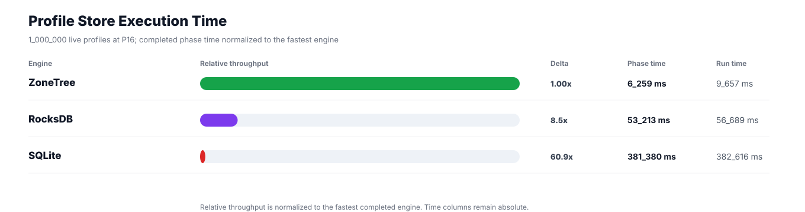
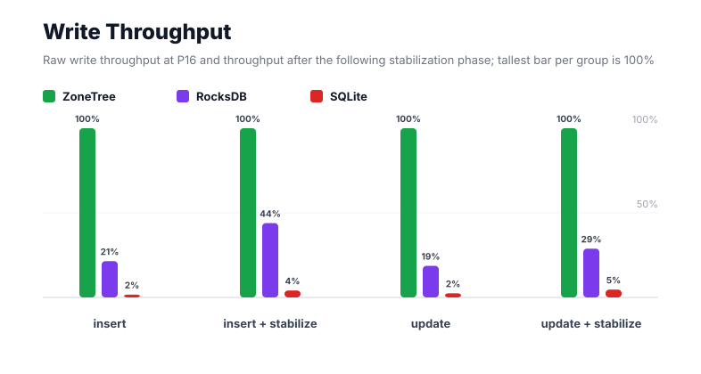
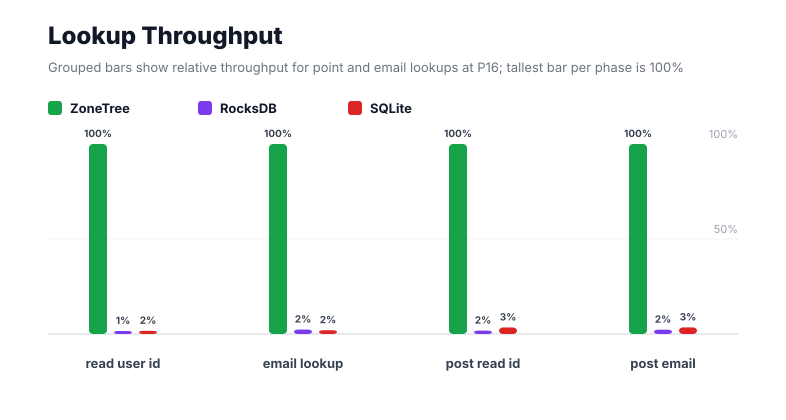
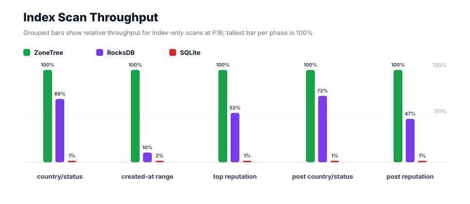
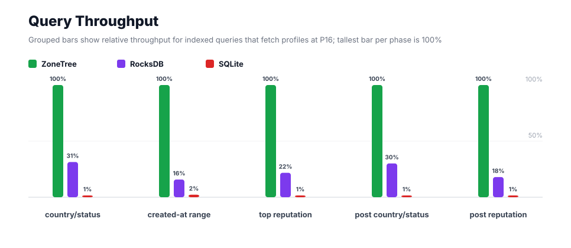
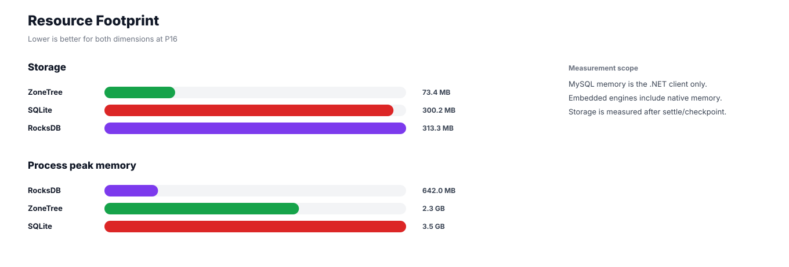

# Benchmark 1M Profiles / P16 - Windows

## Charts

### Execution Time

### Write Throughput

### Lookup Throughput

### Index Scan Throughput

### Query Throughput

### Resource Footprint

## Total By Engine

| Engine | Status | Run time | Completed phase time | Pre-read stabilize | Post-update stabilize | Settle | Reopen | Verify | Storage | Process peak memory | Final checksum |
| --- | --- | ---: | ---: | ---: | ---: | ---: | ---: | ---: | ---: | ---: | --- |
| ZoneTree | Completed | 9_657 ms | 6_259 ms | 1_630 ms | 1_424 ms | 15 ms | 100 ms | 12 ms | 73.4 MB | 2.3 GB | `B7578931045C8FC5` |
| RocksDB | Completed | 56_689 ms | 53_213 ms | 1_063 ms | 1_880 ms | 1 ms | 48 ms | 145 ms | 313.3 MB | 642.0 MB | `B7578931045C8FC5` |
| SQLite | Completed | 382_616 ms | 381_380 ms | n/a | n/a | 1_075 ms | 1 ms | 17 ms | 300.2 MB | 3.5 GB | `B7578931045C8FC5` |

## Correctness

Checksum validation passed across completed engines: ZoneTree, RocksDB, SQLite.

## Interpretation Notes

* This benchmark measures live single-operation profile inserts, updates, reads, and indexed queries.
* ZoneTree and RocksDB secondary indexes are maintained by the benchmark application using separate stores.
* SQLite maintains secondary indexes inside the database engine.
* Embedded engines run in the benchmark process.
* Completed phase time is the sum of measured workload phases. Run time also includes initialization, stabilization, settle/checkpoint, reopen, verification, and reporting overhead.
* The write throughput chart includes raw write phases and derived write-readiness bars that add the following stabilization phase.
* Storage is measured after each engine settles or checkpoints its data.
* Process peak memory is measured for the benchmark process.

## Write Readiness

| Engine | Insert | Pre-read stabilize | Insert + stabilize | Insert ready throughput | Update | Post-update stabilize | Update + stabilize | Update ready throughput |
| --- | ---: | ---: | ---: | ---: | ---: | ---: | ---: | ---: |
| ZoneTree | 1_108 ms | 1_630 ms | 2_738 ms | 365_271/s | 1_618 ms | 1_424 ms | 3_042 ms | 328_695/s |
| RocksDB | 5_170 ms | 1_063 ms | 6_233 ms | 160_449/s | 8_675 ms | 1_880 ms | 10_555 ms | 94_737/s |
| SQLite | 66_540 ms | n/a | 66_540 ms | 15_029/s | 65_911 ms | n/a | 65_911 ms | 15_172/s |

## Phase Results

### ZoneTree

| Phase | Operations | Time | Throughput | Checksum |
| --- | ---: | ---: | ---: | --- |
| insert profiles | 1_000_000 | 1_108 ms | 902_393/s | `FEBD9185EFEF90EA` |
| read by user id | 1_000_000 | 89 ms | 11_276_029/s | `570C7C195BC46EB1` |
| lookup by email | 1_000_000 | 160 ms | 6_239_335/s | `D9A340DA0A79BF2B` |
| scan country/status index | 250_000 | 115 ms | 2_175_133/s | `074C13DEC9D66F9B` |
| query country/status | 250_000 | 489 ms | 511_447/s | `11314C2D73BD8D25` |
| scan created-at index | 250_000 | 219 ms | 1_143_947/s | `2D8343DE38FEB987` |
| query created-at range | 250_000 | 771 ms | 324_175/s | `87784D38A4FA7B1E` |
| scan top reputation index | 250_000 | 99 ms | 2_534_841/s | `E083CDA3090226C5` |
| query top reputation | 250_000 | 349 ms | 716_764/s | `258F00803FCC6F85` |
| update profiles | 1_000_000 | 1_618 ms | 617_936/s | `39DC4EC8871CD076` |
| post-update read by user id | 1_000_000 | 91 ms | 11_018_349/s | `F70B3DE998EC77E8` |
| post-update lookup by email | 1_000_000 | 136 ms | 7_328_445/s | `99A2343A1FC52620` |
| post-update scan country/status index | 250_000 | 140 ms | 1_787_610/s | `793881F928350E78` |
| post-update query country/status | 250_000 | 488 ms | 511_864/s | `85BAEB9A2CEAE7A6` |
| post-update scan top reputation index | 250_000 | 88 ms | 2_845_342/s | `405A6335926BC525` |
| post-update query top reputation | 250_000 | 299 ms | 835_703/s | `B98C6CAA95AB4485` |

### RocksDB

| Phase | Operations | Time | Throughput | Checksum |
| --- | ---: | ---: | ---: | --- |
| insert profiles | 1_000_000 | 5_170 ms | 193_439/s | `FEBD9185EFEF90EA` |
| read by user id | 1_000_000 | 7_269 ms | 137_573/s | `570C7C195BC46EB1` |
| lookup by email | 1_000_000 | 6_864 ms | 145_680/s | `D9A340DA0A79BF2B` |
| scan country/status index | 250_000 | 168 ms | 1_492_030/s | `074C13DEC9D66F9B` |
| query country/status | 250_000 | 1_558 ms | 160_472/s | `11314C2D73BD8D25` |
| scan created-at index | 250_000 | 2_086 ms | 119_856/s | `2D8343DE38FEB987` |
| query created-at range | 250_000 | 4_891 ms | 51_110/s | `87784D38A4FA7B1E` |
| scan top reputation index | 250_000 | 185 ms | 1_354_682/s | `E083CDA3090226C5` |
| query top reputation | 250_000 | 1_602 ms | 156_024/s | `258F00803FCC6F85` |
| update profiles | 1_000_000 | 8_675 ms | 115_268/s | `39DC4EC8871CD076` |
| post-update read by user id | 1_000_000 | 5_074 ms | 197_067/s | `F70B3DE998EC77E8` |
| post-update lookup by email | 1_000_000 | 6_002 ms | 166_599/s | `99A2343A1FC52620` |
| post-update scan country/status index | 250_000 | 194 ms | 1_285_970/s | `793881F928350E78` |
| post-update query country/status | 250_000 | 1_622 ms | 154_152/s | `85BAEB9A2CEAE7A6` |
| post-update scan top reputation index | 250_000 | 187 ms | 1_339_209/s | `405A6335926BC525` |
| post-update query top reputation | 250_000 | 1_665 ms | 150_113/s | `B98C6CAA95AB4485` |

### SQLite

| Phase | Operations | Time | Throughput | Checksum |
| --- | ---: | ---: | ---: | --- |
| insert profiles | 1_000_000 | 66_540 ms | 15_029/s | `FEBD9185EFEF90EA` |
| read by user id | 1_000_000 | 5_308 ms | 188_406/s | `570C7C195BC46EB1` |
| lookup by email | 1_000_000 | 7_991 ms | 125_134/s | `D9A340DA0A79BF2B` |
| scan country/status index | 250_000 | 14_530 ms | 17_206/s | `074C13DEC9D66F9B` |
| query country/status | 250_000 | 35_111 ms | 7_120/s | `11314C2D73BD8D25` |
| scan created-at index | 250_000 | 14_170 ms | 17_643/s | `2D8343DE38FEB987` |
| query created-at range | 250_000 | 34_590 ms | 7_228/s | `87784D38A4FA7B1E` |
| scan top reputation index | 250_000 | 10_156 ms | 24_616/s | `E083CDA3090226C5` |
| query top reputation | 250_000 | 29_932 ms | 8_352/s | `258F00803FCC6F85` |
| update profiles | 1_000_000 | 65_911 ms | 15_172/s | `39DC4EC8871CD076` |
| post-update read by user id | 1_000_000 | 2_650 ms | 377_410/s | `F70B3DE998EC77E8` |
| post-update lookup by email | 1_000_000 | 3_937 ms | 253_989/s | `99A2343A1FC52620` |
| post-update scan country/status index | 250_000 | 14_111 ms | 17_716/s | `793881F928350E78` |
| post-update query country/status | 250_000 | 34_364 ms | 7_275/s | `85BAEB9A2CEAE7A6` |
| post-update scan top reputation index | 250_000 | 10_815 ms | 23_116/s | `405A6335926BC525` |
| post-update query top reputation | 250_000 | 31_265 ms | 7_996/s | `B98C6CAA95AB4485` |

## Configuration

* Profiles: 1_000_000
* Parallelism: 16
* Profile writes: individual operations
* UserId reads: 1_000_000
* Email lookups: 1_000_000
* Query count: 250_000
* Profile updates: 1_000_000
* Post-update UserId reads: 1_000_000
* Post-update email lookups: 1_000_000
* Post-update query count: 250_000
* Query limit: 50
* Seed: 570123434
* Timeout: disabled

## Environment

* OS: Microsoft Windows 10.0.26200
* Architecture: X64
* .NET: 10.0.6
* CPU: Intel(R) Core(TM) Ultra 7 265KF
* Logical processors: 20
* Total available memory: 63.6 GB
* Initial process working set: 143.6 MB
* Benchmark version: 1.0.0.0
* ZoneTree version: 2.0.4.0
* Microsoft.Data.Sqlite version: 10.0.0
* SQLite runtime version: 3.50.3
* SQLitePCLRaw.core version: 2.1.11
* SQLitePCLRaw.lib.e_sqlite3 version: 3.50.3
* RocksDbSharp version: 6.2.2
* RocksDbNative version: 6.2.2
* MySqlConnector version: 2.4.0

## Engine Settings

### ZoneTree

* MutableSegmentMaxItemCount: 250000
* SparseArrayStepSize: 16
* KeyCacheSize: 1024
* ValueCacheSize: 1024
* IteratorPrefetchSize: 16
* BlockCacheLifeTime: 1 minutes
* BottomMergePolicy: Full bottom merge when bottom segment count exceeds 1
* ReadStabilization: Settle before read/query phases

### RocksDB

* Databases: profiles,email-index,country-status-index,created-at-index,reputation-index
* Compression: Zstd
* WriteBufferMb: 1024
* MaxWriteBufferNumber: 4
* WriteSync: false
* ReadStabilization: Compact before read/query phases

### SQLite

* JournalMode: WAL
* Synchronous: NORMAL
* CacheMb: 1024
* MmapMb: 1024
* TempStore: MEMORY

## Durability Settings

* ZoneTree: AsyncCompressed WAL default; MutableSegmentMaxItemCount=250000; SparseArrayStepSize=16; KeyCacheSize=1024; ValueCacheSize=1024; IteratorPrefetchSize=16; BlockCacheLifeTime=1 minutes; application-managed secondary indexes; background maintainers enabled.
* RocksDB: WAL enabled; five separate RocksDB instances; no WriteBatch across indexes; compression=Zstd; write_buffer_size=1024 MB per database; max_write_buffer_number=4.
* SQLite: WAL journal mode; synchronous=NORMAL; cache=1024 MB; mmap=1024 MB; native SQL indexes; single-row writes use autocommit.
