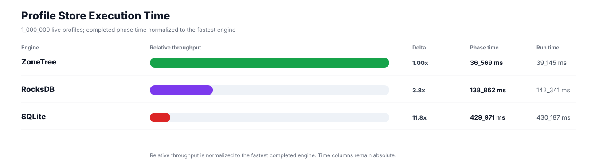
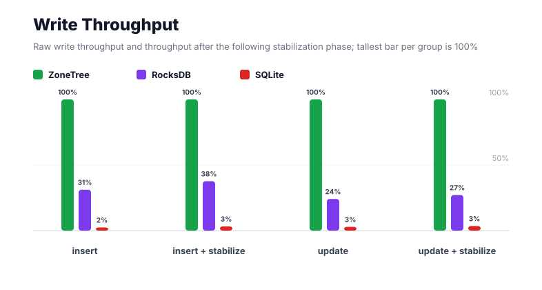
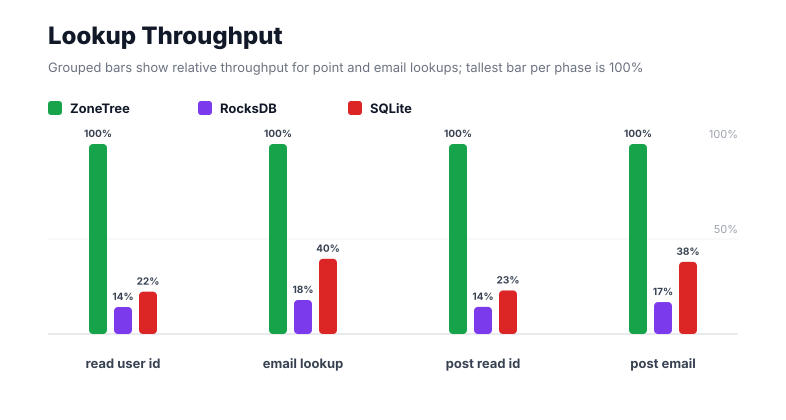
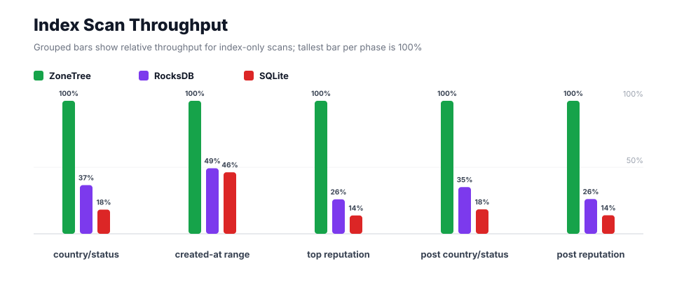
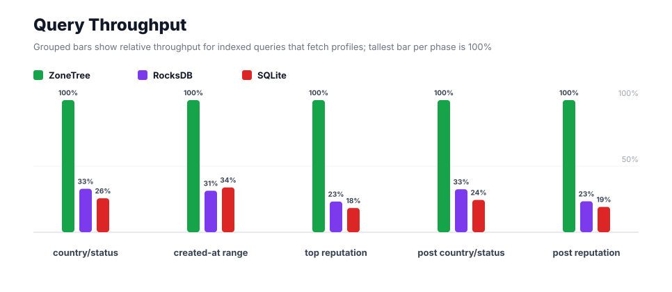
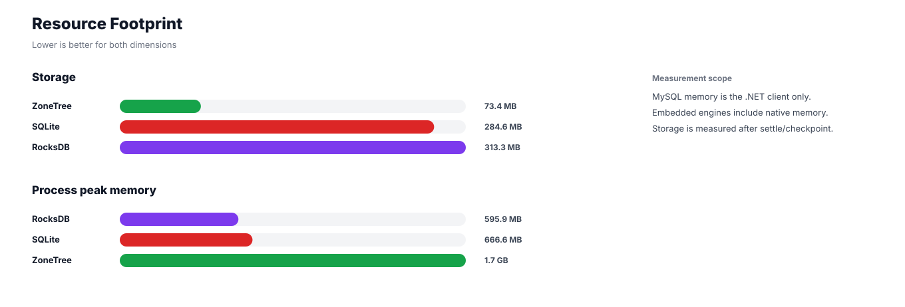

# Benchmark 1M Profiles - Windows

## Charts

### Execution Time

### Write Throughput

### Lookup Throughput

### Index Scan Throughput

### Query Throughput

### Resource Footprint

## Total By Engine

| Engine | Status | Run time | Completed phase time | Pre-read stabilize | Post-update stabilize | Settle | Reopen | Verify | Storage | Process peak memory | Final checksum |
| --- | --- | ---: | ---: | ---: | ---: | ---: | ---: | ---: | ---: | ---: | --- |
| ZoneTree | Completed | 39_145 ms | 36_569 ms | 1_051 ms | 1_192 ms | 12 ms | 100 ms | 12 ms | 73.4 MB | 1.7 GB | `B7578931045C8FC5` |
| RocksDB | Completed | 142_341 ms | 138_862 ms | 1_064 ms | 1_860 ms | 1 ms | 50 ms | 149 ms | 313.3 MB | 595.9 MB | `B7578931045C8FC5` |
| SQLite | Completed | 430_187 ms | 429_971 ms | n/a | n/a | 31 ms | 1 ms | 63 ms | 284.6 MB | 666.6 MB | `B7578931045C8FC5` |

## Correctness

Checksum validation passed across completed engines: ZoneTree, RocksDB, SQLite.

## Interpretation Notes

* This benchmark measures live single-operation profile inserts, updates, reads, and indexed queries.
* ZoneTree and RocksDB secondary indexes are maintained by the benchmark application using separate stores.
* SQLite maintains secondary indexes inside the database engine.
* Embedded engines run in the benchmark process.
* Completed phase time is the sum of measured workload phases. Run time also includes initialization, stabilization, settle/checkpoint, reopen, verification, and reporting overhead.
* The write throughput chart includes raw write phases and derived write-readiness bars that add the following stabilization phase.
* Storage is measured after each engine settles or checkpoints its data.
* Process peak memory is measured for the benchmark process.

## Write Readiness

| Engine | Insert | Pre-read stabilize | Insert + stabilize | Insert ready throughput | Update | Post-update stabilize | Update + stabilize | Update ready throughput |
| --- | ---: | ---: | ---: | ---: | ---: | ---: | ---: | ---: |
| ZoneTree | 3_114 ms | 1_051 ms | 4_165 ms | 240_096/s | 5_439 ms | 1_192 ms | 6_631 ms | 150_806/s |
| RocksDB | 9_993 ms | 1_064 ms | 11_057 ms | 90_442/s | 22_559 ms | 1_860 ms | 24_419 ms | 40_952/s |
| SQLite | 128_194 ms | n/a | 128_194 ms | 7_801/s | 189_857 ms | n/a | 189_857 ms | 5_267/s |

## Phase Results

### ZoneTree

| Phase | Operations | Time | Throughput | Checksum |
| --- | ---: | ---: | ---: | --- |
| insert profiles | 1_000_000 | 3_114 ms | 321_132/s | `70EEB1E90366F6E5` |
| read by user id | 1_000_000 | 646 ms | 1_547_972/s | `0FB577C390019AC8` |
| lookup by email | 1_000_000 | 1_615 ms | 619_204/s | `9C199CC596F7AC10` |
| scan country/status index | 250_000 | 578 ms | 432_848/s | `61A2EA3E2821B78E` |
| query country/status | 250_000 | 4_352 ms | 57_448/s | `59430B6E3710B73A` |
| scan created-at index | 250_000 | 1_440 ms | 173_588/s | `5DCF6A52134EE2E1` |
| query created-at range | 250_000 | 5_368 ms | 46_576/s | `F7273374D314AB37` |
| scan top reputation index | 250_000 | 361 ms | 692_628/s | `29FF27B972C9DD05` |
| query top reputation | 250_000 | 2_955 ms | 84_589/s | `BF3EF75489BD5D95` |
| update profiles | 1_000_000 | 5_439 ms | 183_860/s | `2440ADD57E65500B` |
| post-update read by user id | 1_000_000 | 665 ms | 1_503_481/s | `7DB9AA24CC9A8B8E` |
| post-update lookup by email | 1_000_000 | 1_531 ms | 652_988/s | `43569B6DA38ACCB5` |
| post-update scan country/status index | 250_000 | 564 ms | 443_624/s | `E81A287B61AC0B4A` |
| post-update query country/status | 250_000 | 4_461 ms | 56_045/s | `187087226FE86156` |
| post-update scan top reputation index | 250_000 | 370 ms | 676_205/s | `2FCAC43A8D128B85` |
| post-update query top reputation | 250_000 | 3_111 ms | 80_365/s | `A983697B4465FA75` |

### RocksDB

| Phase | Operations | Time | Throughput | Checksum |
| --- | ---: | ---: | ---: | --- |
| insert profiles | 1_000_000 | 9_993 ms | 100_074/s | `70EEB1E90366F6E5` |
| read by user id | 1_000_000 | 4_548 ms | 219_890/s | `0FB577C390019AC8` |
| lookup by email | 1_000_000 | 9_023 ms | 110_828/s | `9C199CC596F7AC10` |
| scan country/status index | 250_000 | 1_579 ms | 158_373/s | `61A2EA3E2821B78E` |
| query country/status | 250_000 | 13_241 ms | 18_881/s | `59430B6E3710B73A` |
| scan created-at index | 250_000 | 2_923 ms | 85_532/s | `5DCF6A52134EE2E1` |
| query created-at range | 250_000 | 17_095 ms | 14_624/s | `F7273374D314AB37` |
| scan top reputation index | 250_000 | 1_392 ms | 179_575/s | `29FF27B972C9DD05` |
| query top reputation | 250_000 | 12_724 ms | 19_648/s | `BF3EF75489BD5D95` |
| update profiles | 1_000_000 | 22_559 ms | 44_328/s | `2440ADD57E65500B` |
| post-update read by user id | 1_000_000 | 4_659 ms | 214_644/s | `7DB9AA24CC9A8B8E` |
| post-update lookup by email | 1_000_000 | 9_109 ms | 109_777/s | `43569B6DA38ACCB5` |
| post-update scan country/status index | 250_000 | 1_605 ms | 155_790/s | `E81A287B61AC0B4A` |
| post-update query country/status | 250_000 | 13_713 ms | 18_231/s | `187087226FE86156` |
| post-update scan top reputation index | 250_000 | 1_415 ms | 176_684/s | `2FCAC43A8D128B85` |
| post-update query top reputation | 250_000 | 13_286 ms | 18_816/s | `A983697B4465FA75` |

### SQLite

| Phase | Operations | Time | Throughput | Checksum |
| --- | ---: | ---: | ---: | --- |
| insert profiles | 1_000_000 | 128_194 ms | 7_801/s | `70EEB1E90366F6E5` |
| read by user id | 1_000_000 | 2_901 ms | 344_663/s | `0FB577C390019AC8` |
| lookup by email | 1_000_000 | 4_079 ms | 245_154/s | `9C199CC596F7AC10` |
| scan country/status index | 250_000 | 3_176 ms | 78_715/s | `61A2EA3E2821B78E` |
| query country/status | 250_000 | 16_945 ms | 14_754/s | `59430B6E3710B73A` |
| scan created-at index | 250_000 | 3_113 ms | 80_306/s | `5DCF6A52134EE2E1` |
| query created-at range | 250_000 | 15_834 ms | 15_789/s | `F7273374D314AB37` |
| scan top reputation index | 250_000 | 2_618 ms | 95_492/s | `29FF27B972C9DD05` |
| query top reputation | 250_000 | 16_143 ms | 15_487/s | `BF3EF75489BD5D95` |
| update profiles | 1_000_000 | 189_857 ms | 5_267/s | `2440ADD57E65500B` |
| post-update read by user id | 1_000_000 | 2_901 ms | 344_719/s | `7DB9AA24CC9A8B8E` |
| post-update lookup by email | 1_000_000 | 4_034 ms | 247_887/s | `43569B6DA38ACCB5` |
| post-update scan country/status index | 250_000 | 3_064 ms | 81_597/s | `E81A287B61AC0B4A` |
| post-update query country/status | 250_000 | 18_236 ms | 13_709/s | `187087226FE86156` |
| post-update scan top reputation index | 250_000 | 2_651 ms | 94_311/s | `2FCAC43A8D128B85` |
| post-update query top reputation | 250_000 | 16_226 ms | 15_407/s | `A983697B4465FA75` |

## Configuration

* Profiles: 1_000_000
* Parallelism: 1
* Profile writes: individual operations
* UserId reads: 1_000_000
* Email lookups: 1_000_000
* Query count: 250_000
* Profile updates: 1_000_000
* Post-update UserId reads: 1_000_000
* Post-update email lookups: 1_000_000
* Post-update query count: 250_000
* Query limit: 50
* Seed: 570123434
* Timeout: disabled

## Environment

* OS: Microsoft Windows 10.0.26200
* Architecture: X64
* .NET: 10.0.6
* CPU: Intel(R) Core(TM) Ultra 7 265KF
* Logical processors: 20
* Total available memory: 63.6 GB
* Initial process working set: 143.0 MB
* Benchmark version: 1.0.0.0
* ZoneTree version: 2.0.4.0
* Microsoft.Data.Sqlite version: 10.0.0
* SQLite runtime version: 3.50.3
* SQLitePCLRaw.core version: 2.1.11
* SQLitePCLRaw.lib.e_sqlite3 version: 3.50.3
* RocksDbSharp version: 6.2.2
* RocksDbNative version: 6.2.2
* MySqlConnector version: 2.4.0

## Engine Settings

### ZoneTree

* MutableSegmentMaxItemCount: 250000
* SparseArrayStepSize: 16
* KeyCacheSize: 1024
* ValueCacheSize: 1024
* IteratorPrefetchSize: 16
* BlockCacheLifeTime: 1 minutes
* BottomMergePolicy: Full bottom merge when bottom segment count exceeds 1
* ReadStabilization: Settle before read/query phases

### RocksDB

* Databases: profiles,email-index,country-status-index,created-at-index,reputation-index
* Compression: Zstd
* WriteBufferMb: 1024
* MaxWriteBufferNumber: 4
* WriteSync: false
* ReadStabilization: Compact before read/query phases

### SQLite

* JournalMode: WAL
* Synchronous: NORMAL
* CacheMb: 1024
* MmapMb: 1024
* TempStore: MEMORY

## Durability Settings

* ZoneTree: AsyncCompressed WAL default; MutableSegmentMaxItemCount=250000; SparseArrayStepSize=16; KeyCacheSize=1024; ValueCacheSize=1024; IteratorPrefetchSize=16; BlockCacheLifeTime=1 minutes; application-managed secondary indexes; background maintainers enabled.
* RocksDB: WAL enabled; five separate RocksDB instances; no WriteBatch across indexes; compression=Zstd; write_buffer_size=1024 MB per database; max_write_buffer_number=4.
* SQLite: WAL journal mode; synchronous=NORMAL; cache=1024 MB; mmap=1024 MB; native SQL indexes; single-row writes use autocommit.
