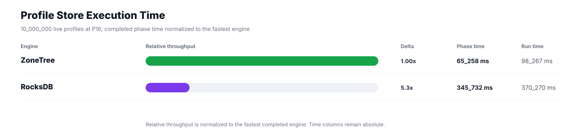
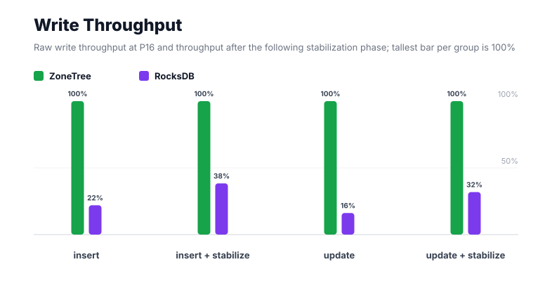
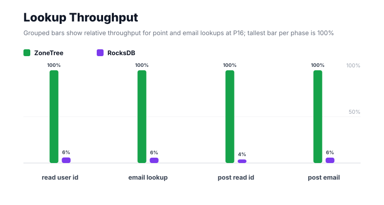
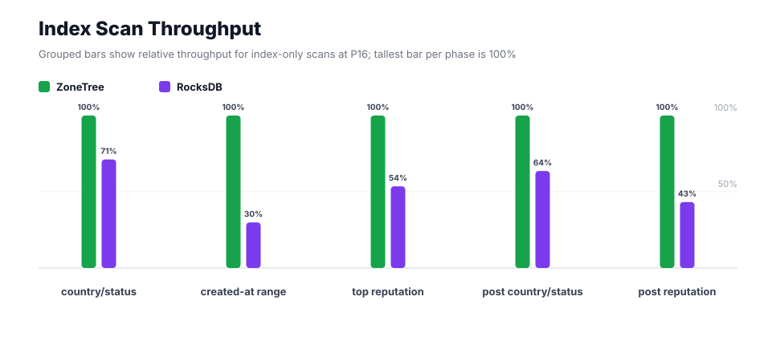
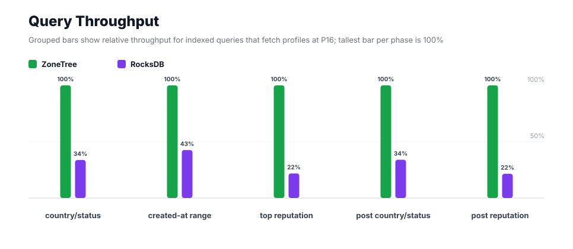
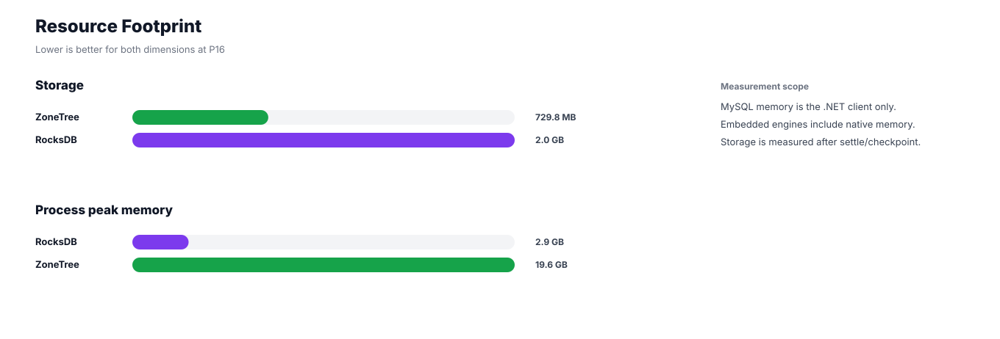

# Benchmark 10M Profiles / P16 - Windows

## Charts

### Execution Time

### Write Throughput

### Lookup Throughput

### Index Scan Throughput

### Query Throughput

### Resource Footprint

## Total By Engine

| Engine | Status | Run time | Completed phase time | Pre-read stabilize | Post-update stabilize | Settle | Reopen | Verify | Storage | Process peak memory | Final checksum |
| --- | --- | ---: | ---: | ---: | ---: | ---: | ---: | ---: | ---: | ---: | --- |
| ZoneTree | Completed | 98_267 ms | 65_258 ms | 12_932 ms | 19_169 ms | 19 ms | 505 ms | 12 ms | 729.8 MB | 19.6 GB | `78E34B89C21C4B51` |
| RocksDB | Completed | 370_270 ms | 345_732 ms | 10_045 ms | 12_125 ms | 1 ms | 50 ms | 1_768 ms | 2.0 GB | 2.9 GB | `78E34B89C21C4B51` |

## Correctness

Checksum validation passed across completed engines: ZoneTree, RocksDB.

## Interpretation Notes

* This benchmark measures live single-operation profile inserts, updates, reads, and indexed queries.
* ZoneTree and RocksDB secondary indexes are maintained by the benchmark application using separate stores.
* Embedded engines run in the benchmark process.
* Completed phase time is the sum of measured workload phases. Run time also includes initialization, stabilization, settle/checkpoint, reopen, verification, and reporting overhead.
* The write throughput chart includes raw write phases and derived write-readiness bars that add the following stabilization phase.
* Storage is measured after each engine settles or checkpoints its data.
* Process peak memory is measured for the benchmark process.

## Write Readiness

| Engine | Insert | Pre-read stabilize | Insert + stabilize | Insert ready throughput | Update | Post-update stabilize | Update + stabilize | Update ready throughput |
| --- | ---: | ---: | ---: | ---: | ---: | ---: | ---: | ---: |
| ZoneTree | 12_171 ms | 12_932 ms | 25_103 ms | 398_357/s | 15_791 ms | 19_169 ms | 34_960 ms | 286_042/s |
| RocksDB | 55_397 ms | 10_045 ms | 65_442 ms | 152_806/s | 97_638 ms | 12_125 ms | 109_762 ms | 91_106/s |

## Phase Results

### ZoneTree

| Phase | Operations | Time | Throughput | Checksum |
| --- | ---: | ---: | ---: | --- |
| insert profiles | 10_000_000 | 12_171 ms | 821_621/s | `60657D05C5C3D63A` |
| read by user id | 10_000_000 | 692 ms | 14_459_624/s | `164E82FF406E47D2` |
| lookup by email | 10_000_000 | 1_903 ms | 5_255_172/s | `9CD5A008A3E41795` |
| scan country/status index | 2_500_000 | 1_016 ms | 2_459_738/s | `EC7FD1325EF846AC` |
| query country/status | 2_500_000 | 5_040 ms | 496_001/s | `40F3106F1D77B892` |
| scan created-at index | 2_500_000 | 2_670 ms | 936_505/s | `BA6DA500E34572F2` |
| query created-at range | 2_500_000 | 8_475 ms | 294_997/s | `DDD17E96EFDE8485` |
| scan top reputation index | 2_500_000 | 928 ms | 2_692_720/s | `51A3F660A0184945` |
| query top reputation | 2_500_000 | 3_582 ms | 697_933/s | `6FAB7460EDD12C85` |
| update profiles | 10_000_000 | 15_791 ms | 633_274/s | `073C2921F3D8CC5D` |
| post-update read by user id | 10_000_000 | 635 ms | 15_737_085/s | `3AFA1FBC5EB0299F` |
| post-update lookup by email | 10_000_000 | 1_944 ms | 5_143_337/s | `D3DBDF6061A6F409` |
| post-update scan country/status index | 2_500_000 | 927 ms | 2_695_861/s | `3B38EC782FF0AA8A` |
| post-update query country/status | 2_500_000 | 5_316 ms | 470_284/s | `AFECAF06842CA75B` |
| post-update scan top reputation index | 2_500_000 | 731 ms | 3_419_647/s | `2AB5FE5D392BC6A5` |
| post-update query top reputation | 2_500_000 | 3_436 ms | 727_590/s | `43A8DFA8C728DD25` |

### RocksDB

| Phase | Operations | Time | Throughput | Checksum |
| --- | ---: | ---: | ---: | --- |
| insert profiles | 10_000_000 | 55_397 ms | 180_515/s | `60657D05C5C3D63A` |
| read by user id | 10_000_000 | 11_555 ms | 865_406/s | `164E82FF406E47D2` |
| lookup by email | 10_000_000 | 33_144 ms | 301_714/s | `9CD5A008A3E41795` |
| scan country/status index | 2_500_000 | 1_427 ms | 1_751_395/s | `EC7FD1325EF846AC` |
| query country/status | 2_500_000 | 14_940 ms | 167_340/s | `40F3106F1D77B892` |
| scan created-at index | 2_500_000 | 8_928 ms | 280_022/s | `BA6DA500E34572F2` |
| query created-at range | 2_500_000 | 19_910 ms | 125_565/s | `DDD17E96EFDE8485` |
| scan top reputation index | 2_500_000 | 1_733 ms | 1_442_403/s | `51A3F660A0184945` |
| query top reputation | 2_500_000 | 16_417 ms | 152_285/s | `6FAB7460EDD12C85` |
| update profiles | 10_000_000 | 97_638 ms | 102_419/s | `073C2921F3D8CC5D` |
| post-update read by user id | 10_000_000 | 16_480 ms | 606_814/s | `3AFA1FBC5EB0299F` |
| post-update lookup by email | 10_000_000 | 33_395 ms | 299_446/s | `D3DBDF6061A6F409` |
| post-update scan country/status index | 2_500_000 | 1_458 ms | 1_714_611/s | `3B38EC782FF0AA8A` |
| post-update query country/status | 2_500_000 | 15_649 ms | 159_751/s | `AFECAF06842CA75B` |
| post-update scan top reputation index | 2_500_000 | 1_690 ms | 1_479_562/s | `2AB5FE5D392BC6A5` |
| post-update query top reputation | 2_500_000 | 15_971 ms | 156_529/s | `43A8DFA8C728DD25` |

## Configuration

* Profiles: 10_000_000
* Parallelism: 16
* Profile writes: individual operations
* UserId reads: 10_000_000
* Email lookups: 10_000_000
* Query count: 2_500_000
* Profile updates: 10_000_000
* Post-update UserId reads: 10_000_000
* Post-update email lookups: 10_000_000
* Post-update query count: 2_500_000
* Query limit: 50
* Seed: 570123434
* Timeout: disabled

## Environment

* OS: Microsoft Windows 10.0.26200
* Architecture: X64
* .NET: 10.0.6
* CPU: Intel(R) Core(TM) Ultra 7 265KF
* Logical processors: 20
* Total available memory: 63.6 GB
* Initial process working set: 770.1 MB
* Benchmark version: 1.0.0.0
* ZoneTree version: 2.0.4.0
* Microsoft.Data.Sqlite version: 10.0.0
* SQLite runtime version: 3.50.3
* SQLitePCLRaw.core version: 2.1.11
* SQLitePCLRaw.lib.e_sqlite3 version: 3.50.3
* RocksDbSharp version: 6.2.2
* RocksDbNative version: 6.2.2
* MySqlConnector version: 2.4.0

## Engine Settings

### ZoneTree

* MutableSegmentMaxItemCount: 250000
* SparseArrayStepSize: 16
* KeyCacheSize: 1024
* ValueCacheSize: 1024
* IteratorPrefetchSize: 16
* BlockCacheLifeTime: 1 minutes
* BottomMergePolicy: Full bottom merge when bottom segment count exceeds 1
* ReadStabilization: Settle before read/query phases

### RocksDB

* Databases: profiles,email-index,country-status-index,created-at-index,reputation-index
* Compression: Zstd
* WriteBufferMb: 1024
* MaxWriteBufferNumber: 4
* WriteSync: false
* ReadStabilization: Compact before read/query phases

## Durability Settings

* ZoneTree: AsyncCompressed WAL default; MutableSegmentMaxItemCount=250000; SparseArrayStepSize=16; KeyCacheSize=1024; ValueCacheSize=1024; IteratorPrefetchSize=16; BlockCacheLifeTime=1 minutes; application-managed secondary indexes; background maintainers enabled.
* RocksDB: WAL enabled; five separate RocksDB instances; no WriteBatch across indexes; compression=Zstd; write_buffer_size=1024 MB per database; max_write_buffer_number=4.
