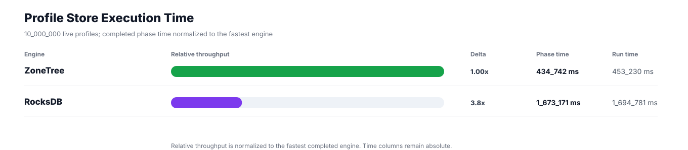
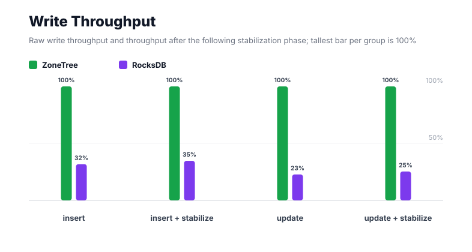
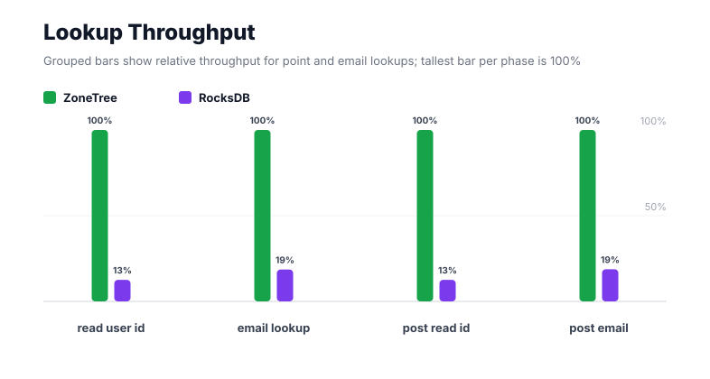
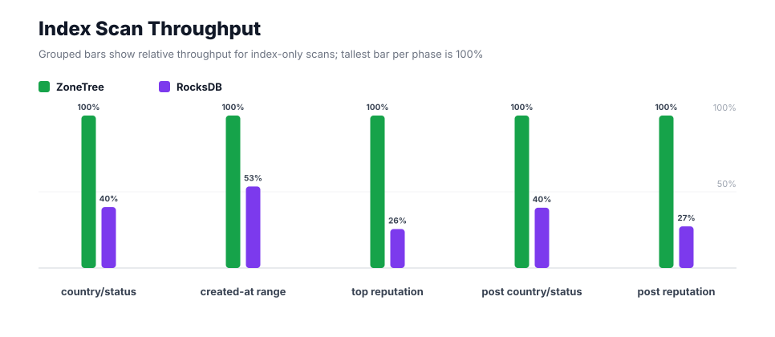
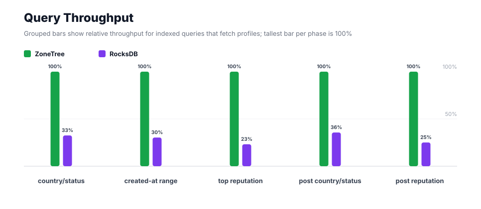
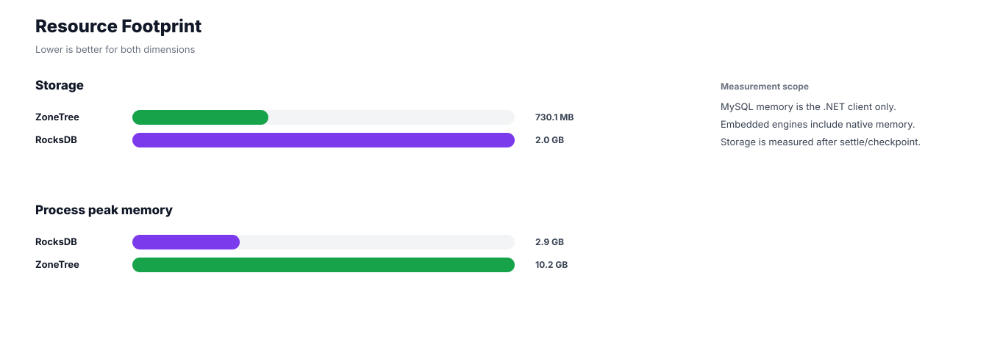

# Benchmark 10M Profiles - Windows

## Charts

### Execution Time

### Write Throughput

### Lookup Throughput

### Index Scan Throughput

### Query Throughput

### Resource Footprint

## Total By Engine

| Engine | Status | Run time | Completed phase time | Pre-read stabilize | Post-update stabilize | Settle | Reopen | Verify | Storage | Process peak memory | Final checksum |
| --- | --- | ---: | ---: | ---: | ---: | ---: | ---: | ---: | ---: | ---: | --- |
| ZoneTree | Completed | 453_230 ms | 434_742 ms | 5_118 ms | 12_393 ms | 19 ms | 537 ms | 13 ms | 730.1 MB | 10.2 GB | `78E34B89C21C4B51` |
| RocksDB | Completed | 1_694_781 ms | 1_673_171 ms | 5_062 ms | 14_118 ms | 1 ms | 47 ms | 1_757 ms | 2.0 GB | 2.9 GB | `78E34B89C21C4B51` |

## Correctness

Checksum validation passed across completed engines: ZoneTree, RocksDB.

## Interpretation Notes

* This benchmark measures live single-operation profile inserts, updates, reads, and indexed queries.
* ZoneTree and RocksDB secondary indexes are maintained by the benchmark application using separate stores.
* Embedded engines run in the benchmark process.
* Completed phase time is the sum of measured workload phases. Run time also includes initialization, stabilization, settle/checkpoint, reopen, verification, and reporting overhead.
* The write throughput chart includes raw write phases and derived write-readiness bars that add the following stabilization phase.
* Storage is measured after each engine settles or checkpoints its data.
* Process peak memory is measured for the benchmark process.

## Write Readiness

| Engine | Insert | Pre-read stabilize | Insert + stabilize | Insert ready throughput | Update | Post-update stabilize | Update + stabilize | Update ready throughput |
| --- | ---: | ---: | ---: | ---: | ---: | ---: | ---: | ---: |
| ZoneTree | 36_447 ms | 5_118 ms | 41_565 ms | 240_589/s | 77_390 ms | 12_393 ms | 89_783 ms | 111_380/s |
| RocksDB | 114_680 ms | 5_062 ms | 119_742 ms | 83_513/s | 339_793 ms | 14_118 ms | 353_910 ms | 28_256/s |

## Phase Results

### ZoneTree

| Phase | Operations | Time | Throughput | Checksum |
| --- | ---: | ---: | ---: | --- |
| insert profiles | 10_000_000 | 36_447 ms | 274_372/s | `07762AC56C55E0A5` |
| read by user id | 10_000_000 | 7_864 ms | 1_271_564/s | `F4608F0DA193D0D9` |
| lookup by email | 10_000_000 | 23_786 ms | 420_423/s | `ADE91BF4BD85A55B` |
| scan country/status index | 2_500_000 | 6_434 ms | 388_586/s | `A29BE83BE119E914` |
| query country/status | 2_500_000 | 47_110 ms | 53_068/s | `3AB5B8133AFFB607` |
| scan created-at index | 2_500_000 | 18_236 ms | 137_092/s | `179FCE1FC14C464D` |
| query created-at range | 2_500_000 | 58_566 ms | 42_687/s | `5FC94052E1F97D6B` |
| scan top reputation index | 2_500_000 | 3_606 ms | 693_196/s | `0D17B3C3B0D7E8E5` |
| query top reputation | 2_500_000 | 32_392 ms | 77_179/s | `8203F6DB8D98AB65` |
| update profiles | 10_000_000 | 77_390 ms | 129_216/s | `6BDE7DC8A52F666F` |
| post-update read by user id | 10_000_000 | 8_039 ms | 1_243_911/s | `5D5C9BD3AB671AA6` |
| post-update lookup by email | 10_000_000 | 23_660 ms | 422_663/s | `D68F7DE2F29ABC22` |
| post-update scan country/status index | 2_500_000 | 6_350 ms | 393_706/s | `974D6B6A832CB320` |
| post-update query country/status | 2_500_000 | 48_566 ms | 51_476/s | `EFC6EAD2344094A4` |
| post-update scan top reputation index | 2_500_000 | 3_737 ms | 669_059/s | `CE24AE7598966365` |
| post-update query top reputation | 2_500_000 | 32_561 ms | 76_780/s | `B53F030441D4FE85` |

### RocksDB

| Phase | Operations | Time | Throughput | Checksum |
| --- | ---: | ---: | ---: | --- |
| insert profiles | 10_000_000 | 114_680 ms | 87_200/s | `07762AC56C55E0A5` |
| read by user id | 10_000_000 | 62_669 ms | 159_568/s | `F4608F0DA193D0D9` |
| lookup by email | 10_000_000 | 128_020 ms | 78_112/s | `ADE91BF4BD85A55B` |
| scan country/status index | 2_500_000 | 16_104 ms | 155_241/s | `A29BE83BE119E914` |
| query country/status | 2_500_000 | 144_868 ms | 17_257/s | `3AB5B8133AFFB607` |
| scan created-at index | 2_500_000 | 34_108 ms | 73_298/s | `179FCE1FC14C464D` |
| query created-at range | 2_500_000 | 193_096 ms | 12_947/s | `5FC94052E1F97D6B` |
| scan top reputation index | 2_500_000 | 14_113 ms | 177_143/s | `0D17B3C3B0D7E8E5` |
| query top reputation | 2_500_000 | 139_727 ms | 17_892/s | `8203F6DB8D98AB65` |
| update profiles | 10_000_000 | 339_793 ms | 29_430/s | `6BDE7DC8A52F666F` |
| post-update read by user id | 10_000_000 | 63_954 ms | 156_363/s | `5D5C9BD3AB671AA6` |
| post-update lookup by email | 10_000_000 | 126_351 ms | 79_145/s | `D68F7DE2F29ABC22` |
| post-update scan country/status index | 2_500_000 | 16_056 ms | 155_707/s | `974D6B6A832CB320` |
| post-update query country/status | 2_500_000 | 136_213 ms | 18_354/s | `EFC6EAD2344094A4` |
| post-update scan top reputation index | 2_500_000 | 13_690 ms | 182_621/s | `CE24AE7598966365` |
| post-update query top reputation | 2_500_000 | 129_730 ms | 19_271/s | `B53F030441D4FE85` |

## Configuration

* Profiles: 10_000_000
* Parallelism: 1
* Profile writes: individual operations
* UserId reads: 10_000_000
* Email lookups: 10_000_000
* Query count: 2_500_000
* Profile updates: 10_000_000
* Post-update UserId reads: 10_000_000
* Post-update email lookups: 10_000_000
* Post-update query count: 2_500_000
* Query limit: 50
* Seed: 570123434
* Timeout: disabled

## Environment

* OS: Microsoft Windows 10.0.26200
* Architecture: X64
* .NET: 10.0.6
* CPU: Intel(R) Core(TM) Ultra 7 265KF
* Logical processors: 20
* Total available memory: 63.6 GB
* Initial process working set: 736.9 MB
* Benchmark version: 1.0.0.0
* ZoneTree version: 2.0.4.0
* Microsoft.Data.Sqlite version: 10.0.0
* SQLite runtime version: 3.50.3
* SQLitePCLRaw.core version: 2.1.11
* SQLitePCLRaw.lib.e_sqlite3 version: 3.50.3
* RocksDbSharp version: 6.2.2
* RocksDbNative version: 6.2.2
* MySqlConnector version: 2.4.0

## Engine Settings

### ZoneTree

* MutableSegmentMaxItemCount: 250000
* SparseArrayStepSize: 16
* KeyCacheSize: 1024
* ValueCacheSize: 1024
* IteratorPrefetchSize: 16
* BlockCacheLifeTime: 1 minutes
* BottomMergePolicy: Full bottom merge when bottom segment count exceeds 1
* ReadStabilization: Settle before read/query phases

### RocksDB

* Databases: profiles,email-index,country-status-index,created-at-index,reputation-index
* Compression: Zstd
* WriteBufferMb: 1024
* MaxWriteBufferNumber: 4
* WriteSync: false
* ReadStabilization: Compact before read/query phases

## Durability Settings

* ZoneTree: AsyncCompressed WAL default; MutableSegmentMaxItemCount=250000; SparseArrayStepSize=16; KeyCacheSize=1024; ValueCacheSize=1024; IteratorPrefetchSize=16; BlockCacheLifeTime=1 minutes; application-managed secondary indexes; background maintainers enabled.
* RocksDB: WAL enabled; five separate RocksDB instances; no WriteBatch across indexes; compression=Zstd; write_buffer_size=1024 MB per database; max_write_buffer_number=4.
