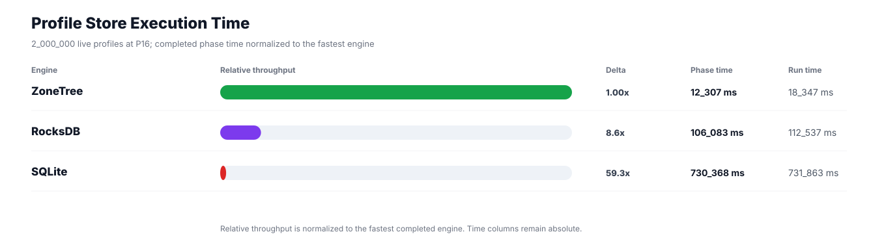
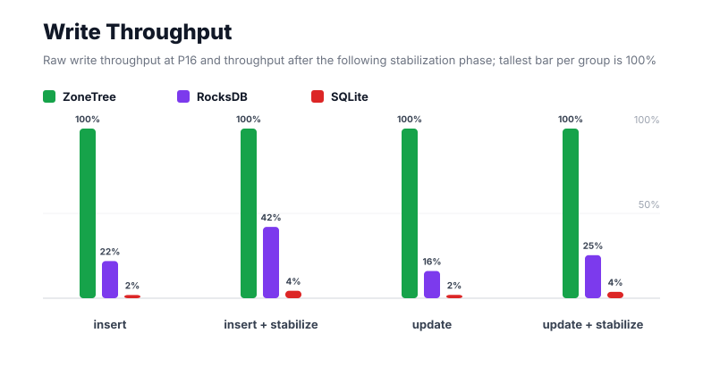
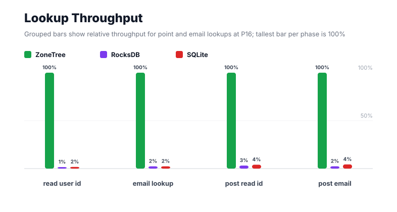
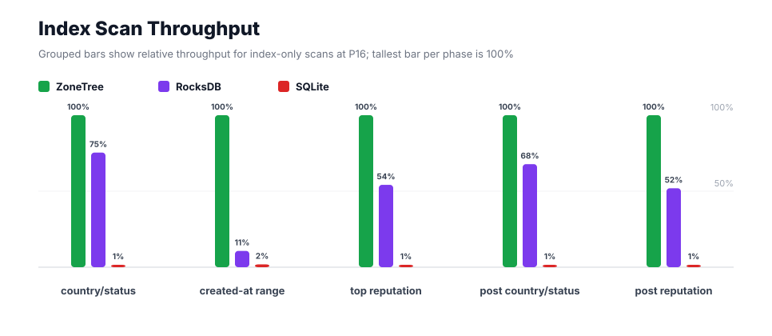
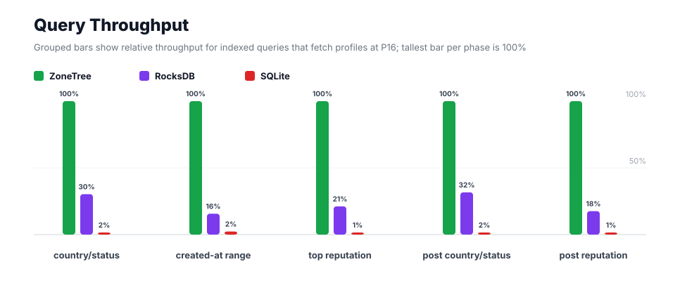
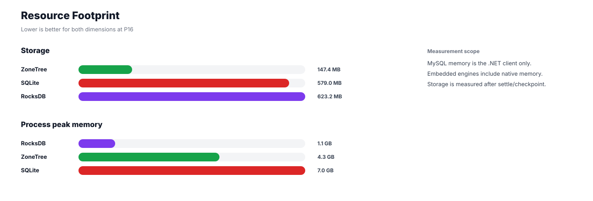

# Benchmark 2M Profiles / P16 - Windows

## Charts

### Execution Time

### Write Throughput

### Lookup Throughput

### Index Scan Throughput

### Query Throughput

### Resource Footprint

## Total By Engine

| Engine | Status | Run time | Completed phase time | Pre-read stabilize | Post-update stabilize | Settle | Reopen | Verify | Storage | Process peak memory | Final checksum |
| --- | --- | ---: | ---: | ---: | ---: | ---: | ---: | ---: | ---: | ---: | --- |
| ZoneTree | Completed | 18_347 ms | 12_307 ms | 3_005 ms | 2_639 ms | 17 ms | 138 ms | 12 ms | 147.4 MB | 4.3 GB | `A7EB98FFC773884D` |
| RocksDB | Completed | 112_537 ms | 106_083 ms | 2_064 ms | 3_702 ms | 1 ms | 49 ms | 289 ms | 623.2 MB | 1.1 GB | `A7EB98FFC773884D` |
| SQLite | Completed | 731_863 ms | 730_368 ms | n/a | n/a | 1_285 ms | 1 ms | 30 ms | 579.0 MB | 7.0 GB | `A7EB98FFC773884D` |

## Correctness

Checksum validation passed across completed engines: ZoneTree, RocksDB, SQLite.

## Interpretation Notes

* This benchmark measures live single-operation profile inserts, updates, reads, and indexed queries.
* ZoneTree and RocksDB secondary indexes are maintained by the benchmark application using separate stores.
* SQLite maintains secondary indexes inside the database engine.
* Embedded engines run in the benchmark process.
* Completed phase time is the sum of measured workload phases. Run time also includes initialization, stabilization, settle/checkpoint, reopen, verification, and reporting overhead.
* The write throughput chart includes raw write phases and derived write-readiness bars that add the following stabilization phase.
* Storage is measured after each engine settles or checkpoints its data.
* Process peak memory is measured for the benchmark process.

## Write Readiness

| Engine | Insert | Pre-read stabilize | Insert + stabilize | Insert ready throughput | Update | Post-update stabilize | Update + stabilize | Update ready throughput |
| --- | ---: | ---: | ---: | ---: | ---: | ---: | ---: | ---: |
| ZoneTree | 2_322 ms | 3_005 ms | 5_327 ms | 375_463/s | 2_925 ms | 2_639 ms | 5_564 ms | 359_462/s |
| RocksDB | 10_606 ms | 2_064 ms | 12_670 ms | 157_853/s | 18_223 ms | 3_702 ms | 21_925 ms | 91_220/s |
| SQLite | 121_614 ms | n/a | 121_614 ms | 16_445/s | 147_818 ms | n/a | 147_818 ms | 13_530/s |

## Phase Results

### ZoneTree

| Phase | Operations | Time | Throughput | Checksum |
| --- | ---: | ---: | ---: | --- |
| insert profiles | 2_000_000 | 2_322 ms | 861_375/s | `2B78272BB2987534` |
| read by user id | 2_000_000 | 169 ms | 11_841_326/s | `18FD8FACB4EB5B65` |
| lookup by email | 2_000_000 | 344 ms | 5_806_791/s | `0C2CB81D0A7184CA` |
| scan country/status index | 500_000 | 230 ms | 2_176_331/s | `54FC0396ADDBA50C` |
| query country/status | 500_000 | 968 ms | 516_781/s | `7BF226FD0368CEF1` |
| scan created-at index | 500_000 | 488 ms | 1_024_249/s | `B1370B4F83D94D56` |
| query created-at range | 500_000 | 1_475 ms | 339_059/s | `68342B1529FE49D8` |
| scan top reputation index | 500_000 | 200 ms | 2_502_738/s | `51197A6A5F249705` |
| query top reputation | 500_000 | 681 ms | 734_124/s | `149050C9EF2101A5` |
| update profiles | 2_000_000 | 2_925 ms | 683_675/s | `AF1D0CFF51ABC807` |
| post-update read by user id | 2_000_000 | 186 ms | 10_737_367/s | `BF327DDD07F65CA5` |
| post-update lookup by email | 2_000_000 | 309 ms | 6_478_392/s | `3240F8217F297852` |
| post-update scan country/status index | 500_000 | 204 ms | 2_456_298/s | `06B0B6C71184C367` |
| post-update query country/status | 500_000 | 1_004 ms | 498_029/s | `AA479A8D3825AD81` |
| post-update scan top reputation index | 500_000 | 193 ms | 2_586_745/s | `B5DDC196C9A394E5` |
| post-update query top reputation | 500_000 | 610 ms | 819_990/s | `9EAD54AC35AC1B85` |

### RocksDB

| Phase | Operations | Time | Throughput | Checksum |
| --- | ---: | ---: | ---: | --- |
| insert profiles | 2_000_000 | 10_606 ms | 188_575/s | `2B78272BB2987534` |
| read by user id | 2_000_000 | 15_259 ms | 131_074/s | `18FD8FACB4EB5B65` |
| lookup by email | 2_000_000 | 14_728 ms | 135_799/s | `0C2CB81D0A7184CA` |
| scan country/status index | 500_000 | 305 ms | 1_640_888/s | `54FC0396ADDBA50C` |
| query country/status | 500_000 | 3_194 ms | 156_531/s | `7BF226FD0368CEF1` |
| scan created-at index | 500_000 | 4_560 ms | 109_646/s | `B1370B4F83D94D56` |
| query created-at range | 500_000 | 9_422 ms | 53_068/s | `68342B1529FE49D8` |
| scan top reputation index | 500_000 | 369 ms | 1_355_997/s | `51197A6A5F249705` |
| query top reputation | 500_000 | 3_220 ms | 155_301/s | `149050C9EF2101A5` |
| update profiles | 2_000_000 | 18_223 ms | 109_753/s | `AF1D0CFF51ABC807` |
| post-update read by user id | 2_000_000 | 5_890 ms | 339_532/s | `BF327DDD07F65CA5` |
| post-update lookup by email | 2_000_000 | 12_993 ms | 153_930/s | `3240F8217F297852` |
| post-update scan country/status index | 500_000 | 300 ms | 1_665_399/s | `06B0B6C71184C367` |
| post-update query country/status | 500_000 | 3_172 ms | 157_606/s | `AA479A8D3825AD81` |
| post-update scan top reputation index | 500_000 | 372 ms | 1_343_338/s | `B5DDC196C9A394E5` |
| post-update query top reputation | 500_000 | 3_470 ms | 144_089/s | `9EAD54AC35AC1B85` |

### SQLite

| Phase | Operations | Time | Throughput | Checksum |
| --- | ---: | ---: | ---: | --- |
| insert profiles | 2_000_000 | 121_614 ms | 16_445/s | `2B78272BB2987534` |
| read by user id | 2_000_000 | 9_752 ms | 205_083/s | `18FD8FACB4EB5B65` |
| lookup by email | 2_000_000 | 14_749 ms | 135_606/s | `0C2CB81D0A7184CA` |
| scan country/status index | 500_000 | 26_995 ms | 18_522/s | `54FC0396ADDBA50C` |
| query country/status | 500_000 | 64_482 ms | 7_754/s | `7BF226FD0368CEF1` |
| scan created-at index | 500_000 | 26_427 ms | 18_920/s | `B1370B4F83D94D56` |
| query created-at range | 500_000 | 63_959 ms | 7_817/s | `68342B1529FE49D8` |
| scan top reputation index | 500_000 | 18_937 ms | 26_404/s | `51197A6A5F249705` |
| query top reputation | 500_000 | 55_181 ms | 9_061/s | `149050C9EF2101A5` |
| update profiles | 2_000_000 | 147_818 ms | 13_530/s | `AF1D0CFF51ABC807` |
| post-update read by user id | 2_000_000 | 4_634 ms | 431_568/s | `BF327DDD07F65CA5` |
| post-update lookup by email | 2_000_000 | 7_109 ms | 281_334/s | `3240F8217F297852` |
| post-update scan country/status index | 500_000 | 26_238 ms | 19_056/s | `06B0B6C71184C367` |
| post-update query country/status | 500_000 | 63_178 ms | 7_914/s | `AA479A8D3825AD81` |
| post-update scan top reputation index | 500_000 | 20_295 ms | 24_637/s | `B5DDC196C9A394E5` |
| post-update query top reputation | 500_000 | 59_000 ms | 8_475/s | `9EAD54AC35AC1B85` |

## Configuration

* Profiles: 2_000_000
* Parallelism: 16
* Profile writes: individual operations
* UserId reads: 2_000_000
* Email lookups: 2_000_000
* Query count: 500_000
* Profile updates: 2_000_000
* Post-update UserId reads: 2_000_000
* Post-update email lookups: 2_000_000
* Post-update query count: 500_000
* Query limit: 50
* Seed: 570123434
* Timeout: disabled

## Environment

* OS: Microsoft Windows 10.0.26200
* Architecture: X64
* .NET: 10.0.6
* CPU: Intel(R) Core(TM) Ultra 7 265KF
* Logical processors: 20
* Total available memory: 63.6 GB
* Initial process working set: 235.9 MB
* Benchmark version: 1.0.0.0
* ZoneTree version: 2.0.4.0
* Microsoft.Data.Sqlite version: 10.0.0
* SQLite runtime version: 3.50.3
* SQLitePCLRaw.core version: 2.1.11
* SQLitePCLRaw.lib.e_sqlite3 version: 3.50.3
* RocksDbSharp version: 6.2.2
* RocksDbNative version: 6.2.2
* MySqlConnector version: 2.4.0

## Engine Settings

### ZoneTree

* MutableSegmentMaxItemCount: 250000
* SparseArrayStepSize: 16
* KeyCacheSize: 1024
* ValueCacheSize: 1024
* IteratorPrefetchSize: 16
* BlockCacheLifeTime: 1 minutes
* BottomMergePolicy: Full bottom merge when bottom segment count exceeds 1
* ReadStabilization: Settle before read/query phases

### RocksDB

* Databases: profiles,email-index,country-status-index,created-at-index,reputation-index
* Compression: Zstd
* WriteBufferMb: 1024
* MaxWriteBufferNumber: 4
* WriteSync: false
* ReadStabilization: Compact before read/query phases

### SQLite

* JournalMode: WAL
* Synchronous: NORMAL
* CacheMb: 1024
* MmapMb: 1024
* TempStore: MEMORY

## Durability Settings

* ZoneTree: AsyncCompressed WAL default; MutableSegmentMaxItemCount=250000; SparseArrayStepSize=16; KeyCacheSize=1024; ValueCacheSize=1024; IteratorPrefetchSize=16; BlockCacheLifeTime=1 minutes; application-managed secondary indexes; background maintainers enabled.
* RocksDB: WAL enabled; five separate RocksDB instances; no WriteBatch across indexes; compression=Zstd; write_buffer_size=1024 MB per database; max_write_buffer_number=4.
* SQLite: WAL journal mode; synchronous=NORMAL; cache=1024 MB; mmap=1024 MB; native SQL indexes; single-row writes use autocommit.
