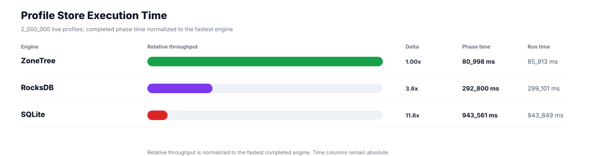
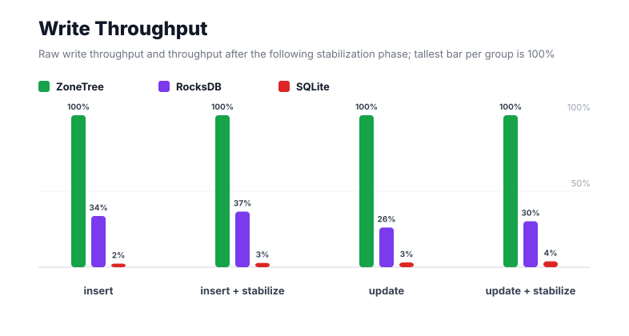
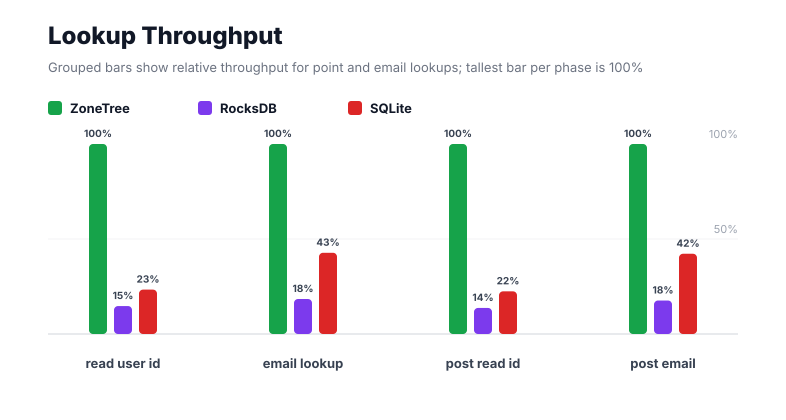
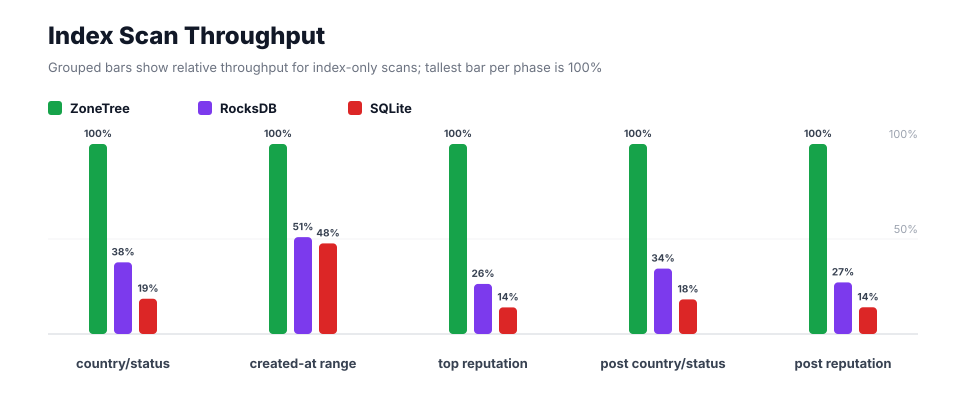
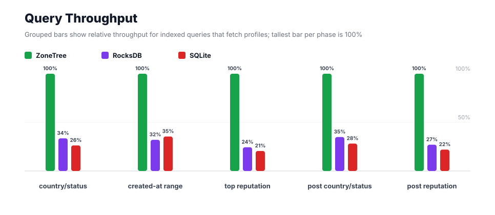
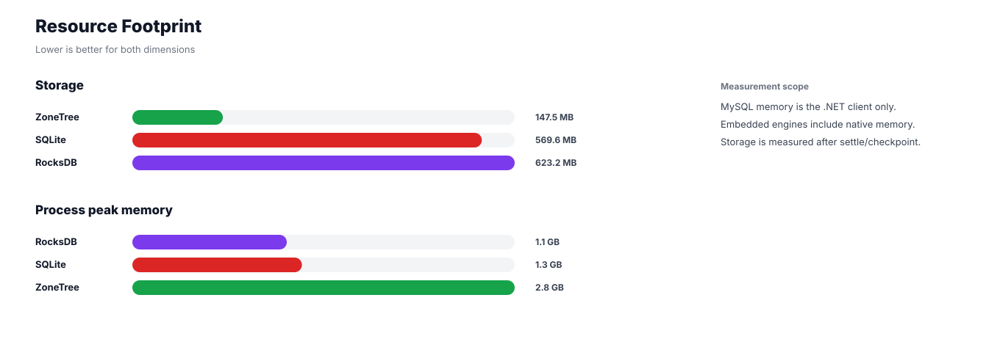

# Benchmark 2M Profiles - Windows

## Charts

### Execution Time

### Write Throughput

### Lookup Throughput

### Index Scan Throughput

### Query Throughput

### Resource Footprint

## Total By Engine

| Engine | Status | Run time | Completed phase time | Pre-read stabilize | Post-update stabilize | Settle | Reopen | Verify | Storage | Process peak memory | Final checksum |
| --- | --- | ---: | ---: | ---: | ---: | ---: | ---: | ---: | ---: | ---: | --- |
| ZoneTree | Completed | 85_913 ms | 80_998 ms | 1_334 ms | 3_167 ms | 13 ms | 149 ms | 13 ms | 147.5 MB | 2.8 GB | `A7EB98FFC773884D` |
| RocksDB | Completed | 299_101 ms | 292_800 ms | 2_021 ms | 3_613 ms | 1 ms | 44 ms | 284 ms | 623.2 MB | 1.1 GB | `A7EB98FFC773884D` |
| SQLite | Completed | 943_849 ms | 943_561 ms | n/a | n/a | 24 ms | 1 ms | 125 ms | 569.6 MB | 1.3 GB | `A7EB98FFC773884D` |

## Correctness

Checksum validation passed across completed engines: ZoneTree, RocksDB, SQLite.

## Interpretation Notes

* This benchmark measures live single-operation profile inserts, updates, reads, and indexed queries.
* ZoneTree and RocksDB secondary indexes are maintained by the benchmark application using separate stores.
* SQLite maintains secondary indexes inside the database engine.
* Embedded engines run in the benchmark process.
* Completed phase time is the sum of measured workload phases. Run time also includes initialization, stabilization, settle/checkpoint, reopen, verification, and reporting overhead.
* The write throughput chart includes raw write phases and derived write-readiness bars that add the following stabilization phase.
* Storage is measured after each engine settles or checkpoints its data.
* Process peak memory is measured for the benchmark process.

## Write Readiness

| Engine | Insert | Pre-read stabilize | Insert + stabilize | Insert ready throughput | Update | Post-update stabilize | Update + stabilize | Update ready throughput |
| --- | ---: | ---: | ---: | ---: | ---: | ---: | ---: | ---: |
| ZoneTree | 6_914 ms | 1_334 ms | 8_248 ms | 242_473/s | 13_246 ms | 3_167 ms | 16_413 ms | 121_853/s |
| RocksDB | 20_523 ms | 2_021 ms | 22_544 ms | 88_715/s | 50_714 ms | 3_613 ms | 54_327 ms | 36_814/s |
| SQLite | 292_643 ms | n/a | 292_643 ms | 6_834/s | 426_092 ms | n/a | 426_092 ms | 4_694/s |

## Phase Results

### ZoneTree

| Phase | Operations | Time | Throughput | Checksum |
| --- | ---: | ---: | ---: | --- |
| insert profiles | 2_000_000 | 6_914 ms | 289_268/s | `4F24F178E189EEA5` |
| read by user id | 2_000_000 | 1_403 ms | 1_425_072/s | `94FEA7BBDF9EB16F` |
| lookup by email | 2_000_000 | 3_604 ms | 554_913/s | `7911E6F89610C9DB` |
| scan country/status index | 500_000 | 1_150 ms | 434_881/s | `FF334B02B19EEB47` |
| query country/status | 500_000 | 9_196 ms | 54_371/s | `7A39FF8F682EA682` |
| scan created-at index | 500_000 | 3_034 ms | 164_782/s | `BF45DF5EE0C200CD` |
| query created-at range | 500_000 | 11_443 ms | 43_695/s | `D3E6F86C306E84D2` |
| scan top reputation index | 500_000 | 733 ms | 682_252/s | `2A869DDD6838E065` |
| query top reputation | 500_000 | 6_621 ms | 75_514/s | `D35AC53DF1237365` |
| update profiles | 2_000_000 | 13_246 ms | 150_984/s | `1100814B966927C5` |
| post-update read by user id | 2_000_000 | 1_362 ms | 1_468_394/s | `B004A4D20A4A3848` |
| post-update lookup by email | 2_000_000 | 3_543 ms | 564_457/s | `D353A40B4BEBE4B5` |
| post-update scan country/status index | 500_000 | 1_124 ms | 444_788/s | `3875E1E8C236F0F9` |
| post-update query country/status | 500_000 | 9_726 ms | 51_411/s | `7DB733996D701F52` |
| post-update scan top reputation index | 500_000 | 749 ms | 667_865/s | `B99A64873AA64365` |
| post-update query top reputation | 500_000 | 7_149 ms | 69_935/s | `BFED9315B44CCEE5` |

### RocksDB

| Phase | Operations | Time | Throughput | Checksum |
| --- | ---: | ---: | ---: | --- |
| insert profiles | 2_000_000 | 20_523 ms | 97_453/s | `4F24F178E189EEA5` |
| read by user id | 2_000_000 | 9_545 ms | 209_528/s | `94FEA7BBDF9EB16F` |
| lookup by email | 2_000_000 | 19_577 ms | 102_163/s | `7911E6F89610C9DB` |
| scan country/status index | 500_000 | 3_048 ms | 164_038/s | `FF334B02B19EEB47` |
| query country/status | 500_000 | 27_418 ms | 18_236/s | `7A39FF8F682EA682` |
| scan created-at index | 500_000 | 5_953 ms | 83_990/s | `BF45DF5EE0C200CD` |
| query created-at range | 500_000 | 35_711 ms | 14_001/s | `D3E6F86C306E84D2` |
| scan top reputation index | 500_000 | 2_780 ms | 179_855/s | `2A869DDD6838E065` |
| query top reputation | 500_000 | 27_139 ms | 18_423/s | `D35AC53DF1237365` |
| update profiles | 2_000_000 | 50_714 ms | 39_437/s | `1100814B966927C5` |
| post-update read by user id | 2_000_000 | 9_934 ms | 201_326/s | `B004A4D20A4A3848` |
| post-update lookup by email | 2_000_000 | 20_109 ms | 99_460/s | `D353A40B4BEBE4B5` |
| post-update scan country/status index | 500_000 | 3_264 ms | 153_175/s | `3875E1E8C236F0F9` |
| post-update query country/status | 500_000 | 27_857 ms | 17_949/s | `7DB733996D701F52` |
| post-update scan top reputation index | 500_000 | 2_756 ms | 181_405/s | `B99A64873AA64365` |
| post-update query top reputation | 500_000 | 26_472 ms | 18_888/s | `BFED9315B44CCEE5` |

### SQLite

| Phase | Operations | Time | Throughput | Checksum |
| --- | ---: | ---: | ---: | --- |
| insert profiles | 2_000_000 | 292_643 ms | 6_834/s | `4F24F178E189EEA5` |
| read by user id | 2_000_000 | 6_009 ms | 332_817/s | `94FEA7BBDF9EB16F` |
| lookup by email | 2_000_000 | 8_431 ms | 237_211/s | `7911E6F89610C9DB` |
| scan country/status index | 500_000 | 6_195 ms | 80_705/s | `FF334B02B19EEB47` |
| query country/status | 500_000 | 35_032 ms | 14_273/s | `7A39FF8F682EA682` |
| scan created-at index | 500_000 | 6_363 ms | 78_585/s | `BF45DF5EE0C200CD` |
| query created-at range | 500_000 | 32_292 ms | 15_484/s | `D3E6F86C306E84D2` |
| scan top reputation index | 500_000 | 5_229 ms | 95_619/s | `2A869DDD6838E065` |
| query top reputation | 500_000 | 32_222 ms | 15_517/s | `D35AC53DF1237365` |
| update profiles | 2_000_000 | 426_092 ms | 4_694/s | `1100814B966927C5` |
| post-update read by user id | 2_000_000 | 6_068 ms | 329_578/s | `B004A4D20A4A3848` |
| post-update lookup by email | 2_000_000 | 8_390 ms | 238_366/s | `D353A40B4BEBE4B5` |
| post-update scan country/status index | 500_000 | 6_173 ms | 80_996/s | `3875E1E8C236F0F9` |
| post-update query country/status | 500_000 | 34_535 ms | 14_478/s | `7DB733996D701F52` |
| post-update scan top reputation index | 500_000 | 5_321 ms | 93_961/s | `B99A64873AA64365` |
| post-update query top reputation | 500_000 | 32_565 ms | 15_354/s | `BFED9315B44CCEE5` |

## Configuration

* Profiles: 2_000_000
* Parallelism: 1
* Profile writes: individual operations
* UserId reads: 2_000_000
* Email lookups: 2_000_000
* Query count: 500_000
* Profile updates: 2_000_000
* Post-update UserId reads: 2_000_000
* Post-update email lookups: 2_000_000
* Post-update query count: 500_000
* Query limit: 50
* Seed: 570123434
* Timeout: disabled

## Environment

* OS: Microsoft Windows 10.0.26200
* Architecture: X64
* .NET: 10.0.6
* CPU: Intel(R) Core(TM) Ultra 7 265KF
* Logical processors: 20
* Total available memory: 63.6 GB
* Initial process working set: 234.0 MB
* Benchmark version: 1.0.0.0
* ZoneTree version: 2.0.4.0
* Microsoft.Data.Sqlite version: 10.0.0
* SQLite runtime version: 3.50.3
* SQLitePCLRaw.core version: 2.1.11
* SQLitePCLRaw.lib.e_sqlite3 version: 3.50.3
* RocksDbSharp version: 6.2.2
* RocksDbNative version: 6.2.2
* MySqlConnector version: 2.4.0

## Engine Settings

### ZoneTree

* MutableSegmentMaxItemCount: 250000
* SparseArrayStepSize: 16
* KeyCacheSize: 1024
* ValueCacheSize: 1024
* IteratorPrefetchSize: 16
* BlockCacheLifeTime: 1 minutes
* BottomMergePolicy: Full bottom merge when bottom segment count exceeds 1
* ReadStabilization: Settle before read/query phases

### RocksDB

* Databases: profiles,email-index,country-status-index,created-at-index,reputation-index
* Compression: Zstd
* WriteBufferMb: 1024
* MaxWriteBufferNumber: 4
* WriteSync: false
* ReadStabilization: Compact before read/query phases

### SQLite

* JournalMode: WAL
* Synchronous: NORMAL
* CacheMb: 1024
* MmapMb: 1024
* TempStore: MEMORY

## Durability Settings

* ZoneTree: AsyncCompressed WAL default; MutableSegmentMaxItemCount=250000; SparseArrayStepSize=16; KeyCacheSize=1024; ValueCacheSize=1024; IteratorPrefetchSize=16; BlockCacheLifeTime=1 minutes; application-managed secondary indexes; background maintainers enabled.
* RocksDB: WAL enabled; five separate RocksDB instances; no WriteBatch across indexes; compression=Zstd; write_buffer_size=1024 MB per database; max_write_buffer_number=4.
* SQLite: WAL journal mode; synchronous=NORMAL; cache=1024 MB; mmap=1024 MB; native SQL indexes; single-row writes use autocommit.
