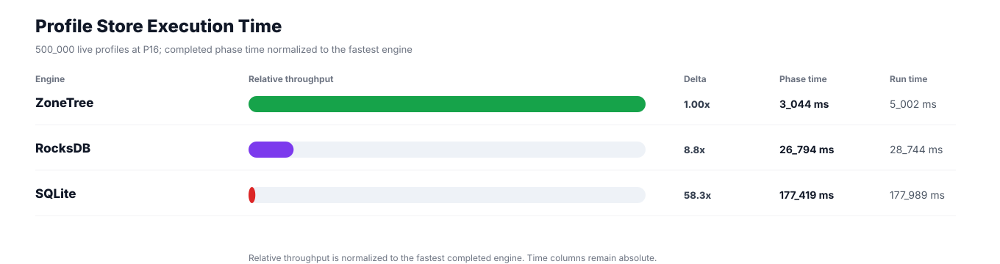
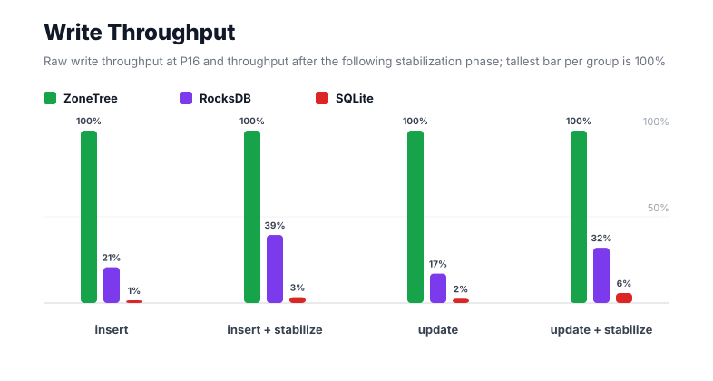
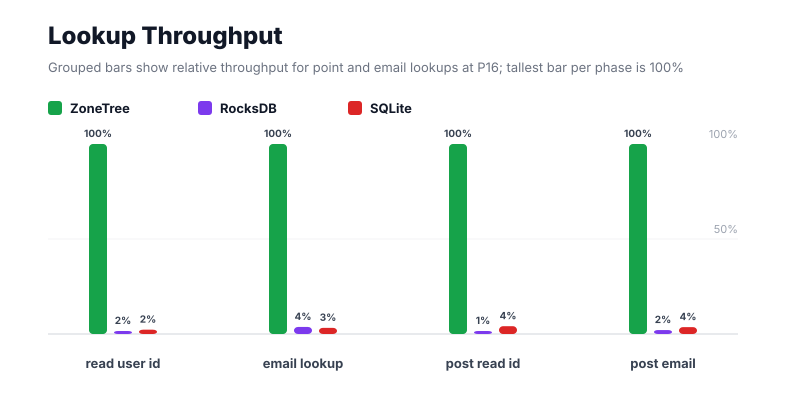
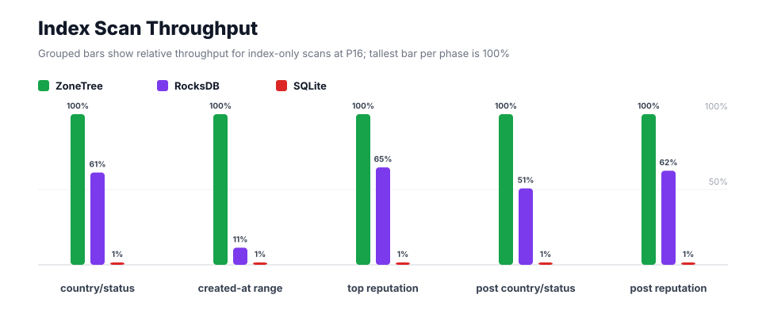
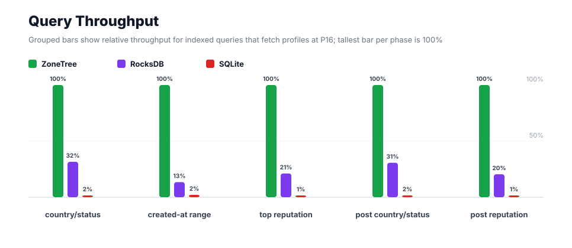
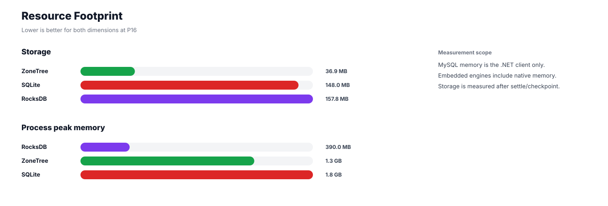

# Benchmark 500K Profiles / P16 - Windows

## Charts

### Execution Time

### Write Throughput

### Lookup Throughput

### Index Scan Throughput

### Query Throughput

### Resource Footprint

## Total By Engine

| Engine | Status | Run time | Completed phase time | Pre-read stabilize | Post-update stabilize | Settle | Reopen | Verify | Storage | Process peak memory | Final checksum |
| --- | --- | ---: | ---: | ---: | ---: | ---: | ---: | ---: | ---: | ---: | --- |
| ZoneTree | Completed | 5_002 ms | 3_044 ms | 701 ms | 942 ms | 14 ms | 82 ms | 12 ms | 36.9 MB | 1.3 GB | `DF2D9443B36E4083` |
| RocksDB | Completed | 28_744 ms | 26_794 ms | 557 ms | 972 ms | 1 ms | 47 ms | 76 ms | 157.8 MB | 390.0 MB | `DF2D9443B36E4083` |
| SQLite | Completed | 177_989 ms | 177_419 ms | n/a | n/a | 430 ms | 1 ms | 10 ms | 148.0 MB | 1.8 GB | `DF2D9443B36E4083` |

## Correctness

Checksum validation passed across completed engines: ZoneTree, RocksDB, SQLite.

## Interpretation Notes

* This benchmark measures live single-operation profile inserts, updates, reads, and indexed queries.
* ZoneTree and RocksDB secondary indexes are maintained by the benchmark application using separate stores.
* SQLite maintains secondary indexes inside the database engine.
* Embedded engines run in the benchmark process.
* Completed phase time is the sum of measured workload phases. Run time also includes initialization, stabilization, settle/checkpoint, reopen, verification, and reporting overhead.
* The write throughput chart includes raw write phases and derived write-readiness bars that add the following stabilization phase.
* Storage is measured after each engine settles or checkpoints its data.
* Process peak memory is measured for the benchmark process.

## Write Readiness

| Engine | Insert | Pre-read stabilize | Insert + stabilize | Insert ready throughput | Update | Post-update stabilize | Update + stabilize | Update ready throughput |
| --- | ---: | ---: | ---: | ---: | ---: | ---: | ---: | ---: |
| ZoneTree | 534 ms | 701 ms | 1_235 ms | 404_725/s | 718 ms | 942 ms | 1_661 ms | 301_102/s |
| RocksDB | 2_575 ms | 557 ms | 3_132 ms | 159_639/s | 4_211 ms | 972 ms | 5_182 ms | 96_480/s |
| SQLite | 36_778 ms | n/a | 36_778 ms | 13_595/s | 28_757 ms | n/a | 28_757 ms | 17_387/s |

## Phase Results

### ZoneTree

| Phase | Operations | Time | Throughput | Checksum |
| --- | ---: | ---: | ---: | --- |
| insert profiles | 500_000 | 534 ms | 935_774/s | `50011E4C9D5F3019` |
| read by user id | 500_000 | 54 ms | 9_303_797/s | `F3B941DE4C92818E` |
| lookup by email | 500_000 | 116 ms | 4_307_003/s | `40C0411114A3A804` |
| scan country/status index | 125_000 | 67 ms | 1_857_005/s | `1B1C2F0D73543877` |
| query country/status | 125_000 | 250 ms | 499_629/s | `2F314B7F8E40E3D9` |
| scan created-at index | 125_000 | 93 ms | 1_345_773/s | `F2636513B5F3CD4C` |
| query created-at range | 125_000 | 332 ms | 376_304/s | `E2906385B10DFC3E` |
| scan top reputation index | 125_000 | 58 ms | 2_171_077/s | `E6264551104EB4A5` |
| query top reputation | 125_000 | 176 ms | 709_257/s | `7A0CCC6AFE1F7735` |
| update profiles | 500_000 | 718 ms | 696_087/s | `CE4B50575224FE7D` |
| post-update read by user id | 500_000 | 48 ms | 10_519_185/s | `79C378667BBF73CE` |
| post-update lookup by email | 500_000 | 65 ms | 7_748_923/s | `0524A9D61F6190E5` |
| post-update scan country/status index | 125_000 | 55 ms | 2_277_004/s | `63B6F85AED445147` |
| post-update query country/status | 125_000 | 253 ms | 494_737/s | `2FE41B172678D1CC` |
| post-update scan top reputation index | 125_000 | 54 ms | 2_317_751/s | `8B8F035B222D5F35` |
| post-update query top reputation | 125_000 | 171 ms | 730_149/s | `14538CD9CDA8AA65` |

### RocksDB

| Phase | Operations | Time | Throughput | Checksum |
| --- | ---: | ---: | ---: | --- |
| insert profiles | 500_000 | 2_575 ms | 194_199/s | `50011E4C9D5F3019` |
| read by user id | 500_000 | 3_401 ms | 147_013/s | `F3B941DE4C92818E` |
| lookup by email | 500_000 | 3_135 ms | 159_479/s | `40C0411114A3A804` |
| scan country/status index | 125_000 | 110 ms | 1_137_878/s | `1B1C2F0D73543877` |
| query country/status | 125_000 | 793 ms | 157_709/s | `2F314B7F8E40E3D9` |
| scan created-at index | 125_000 | 817 ms | 152_998/s | `F2636513B5F3CD4C` |
| query created-at range | 125_000 | 2_471 ms | 50_590/s | `E2906385B10DFC3E` |
| scan top reputation index | 125_000 | 89 ms | 1_404_315/s | `E6264551104EB4A5` |
| query top reputation | 125_000 | 832 ms | 150_163/s | `7A0CCC6AFE1F7735` |
| update profiles | 500_000 | 4_211 ms | 118_749/s | `CE4B50575224FE7D` |
| post-update read by user id | 500_000 | 3_408 ms | 146_728/s | `79C378667BBF73CE` |
| post-update lookup by email | 500_000 | 3_099 ms | 161_344/s | `0524A9D61F6190E5` |
| post-update scan country/status index | 125_000 | 108 ms | 1_155_498/s | `63B6F85AED445147` |
| post-update query country/status | 125_000 | 823 ms | 151_944/s | `2FE41B172678D1CC` |
| post-update scan top reputation index | 125_000 | 86 ms | 1_447_667/s | `8B8F035B222D5F35` |
| post-update query top reputation | 125_000 | 837 ms | 149_358/s | `14538CD9CDA8AA65` |

### SQLite

| Phase | Operations | Time | Throughput | Checksum |
| --- | ---: | ---: | ---: | --- |
| insert profiles | 500_000 | 36_778 ms | 13_595/s | `50011E4C9D5F3019` |
| read by user id | 500_000 | 2_374 ms | 210_642/s | `F3B941DE4C92818E` |
| lookup by email | 500_000 | 3_583 ms | 139_554/s | `40C0411114A3A804` |
| scan country/status index | 125_000 | 6_565 ms | 19_041/s | `1B1C2F0D73543877` |
| query country/status | 125_000 | 15_655 ms | 7_985/s | `2F314B7F8E40E3D9` |
| scan created-at index | 125_000 | 6_467 ms | 19_328/s | `F2636513B5F3CD4C` |
| query created-at range | 125_000 | 15_560 ms | 8_033/s | `E2906385B10DFC3E` |
| scan top reputation index | 125_000 | 4_647 ms | 26_898/s | `E6264551104EB4A5` |
| query top reputation | 125_000 | 13_294 ms | 9_403/s | `7A0CCC6AFE1F7735` |
| update profiles | 500_000 | 28_757 ms | 17_387/s | `CE4B50575224FE7D` |
| post-update read by user id | 500_000 | 1_161 ms | 430_558/s | `79C378667BBF73CE` |
| post-update lookup by email | 500_000 | 1_776 ms | 281_583/s | `0524A9D61F6190E5` |
| post-update scan country/status index | 125_000 | 6_410 ms | 19_500/s | `63B6F85AED445147` |
| post-update query country/status | 125_000 | 15_198 ms | 8_225/s | `2FE41B172678D1CC` |
| post-update scan top reputation index | 125_000 | 4_916 ms | 25_428/s | `8B8F035B222D5F35` |
| post-update query top reputation | 125_000 | 14_278 ms | 8_755/s | `14538CD9CDA8AA65` |

## Configuration

* Profiles: 500_000
* Parallelism: 16
* Profile writes: individual operations
* UserId reads: 500_000
* Email lookups: 500_000
* Query count: 125_000
* Profile updates: 500_000
* Post-update UserId reads: 500_000
* Post-update email lookups: 500_000
* Post-update query count: 125_000
* Query limit: 50
* Seed: 570123434
* Timeout: disabled

## Environment

* OS: Microsoft Windows 10.0.26200
* Architecture: X64
* .NET: 10.0.6
* CPU: Intel(R) Core(TM) Ultra 7 265KF
* Logical processors: 20
* Total available memory: 63.6 GB
* Initial process working set: 101.0 MB
* Benchmark version: 1.0.0.0
* ZoneTree version: 2.0.4.0
* Microsoft.Data.Sqlite version: 10.0.0
* SQLite runtime version: 3.50.3
* SQLitePCLRaw.core version: 2.1.11
* SQLitePCLRaw.lib.e_sqlite3 version: 3.50.3
* RocksDbSharp version: 6.2.2
* RocksDbNative version: 6.2.2
* MySqlConnector version: 2.4.0

## Engine Settings

### ZoneTree

* MutableSegmentMaxItemCount: 250000
* SparseArrayStepSize: 16
* KeyCacheSize: 1024
* ValueCacheSize: 1024
* IteratorPrefetchSize: 16
* BlockCacheLifeTime: 1 minutes
* BottomMergePolicy: Full bottom merge when bottom segment count exceeds 1
* ReadStabilization: Settle before read/query phases

### RocksDB

* Databases: profiles,email-index,country-status-index,created-at-index,reputation-index
* Compression: Zstd
* WriteBufferMb: 1024
* MaxWriteBufferNumber: 4
* WriteSync: false
* ReadStabilization: Compact before read/query phases

### SQLite

* JournalMode: WAL
* Synchronous: NORMAL
* CacheMb: 1024
* MmapMb: 1024
* TempStore: MEMORY

## Durability Settings

* ZoneTree: AsyncCompressed WAL default; MutableSegmentMaxItemCount=250000; SparseArrayStepSize=16; KeyCacheSize=1024; ValueCacheSize=1024; IteratorPrefetchSize=16; BlockCacheLifeTime=1 minutes; application-managed secondary indexes; background maintainers enabled.
* RocksDB: WAL enabled; five separate RocksDB instances; no WriteBatch across indexes; compression=Zstd; write_buffer_size=1024 MB per database; max_write_buffer_number=4.
* SQLite: WAL journal mode; synchronous=NORMAL; cache=1024 MB; mmap=1024 MB; native SQL indexes; single-row writes use autocommit.
