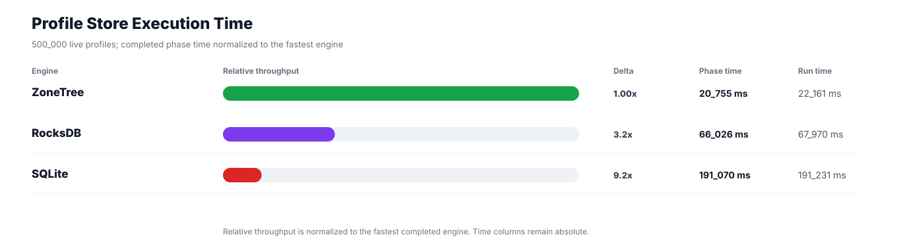
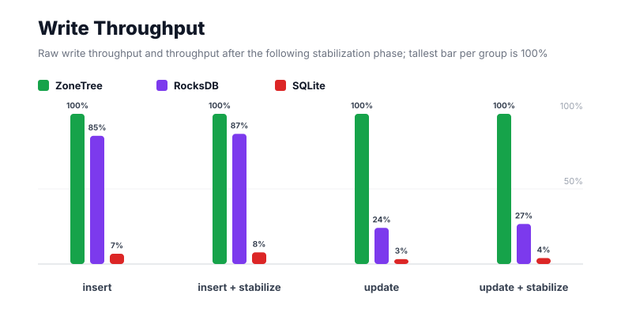
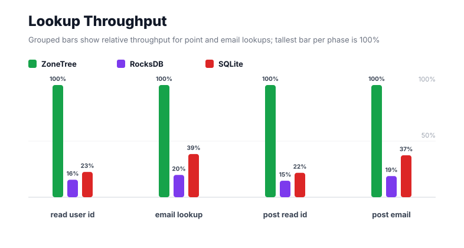
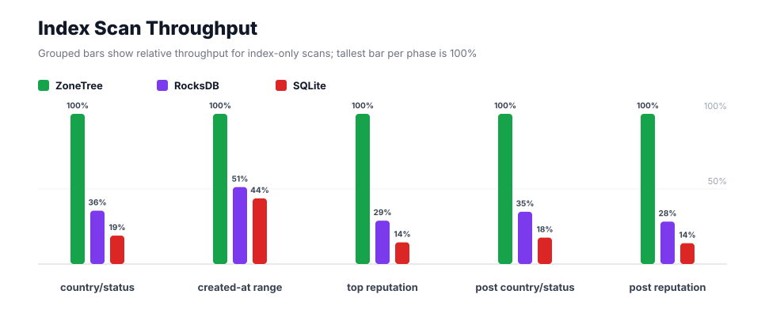
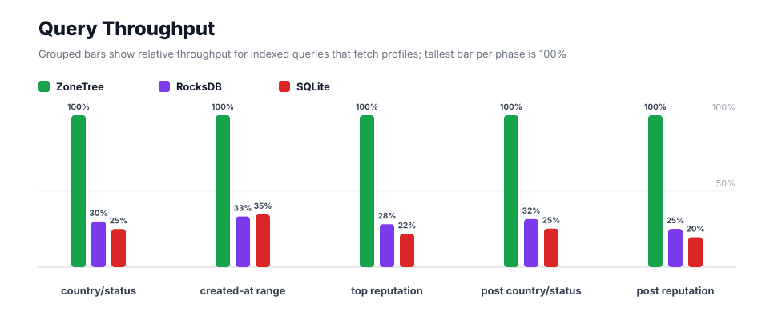
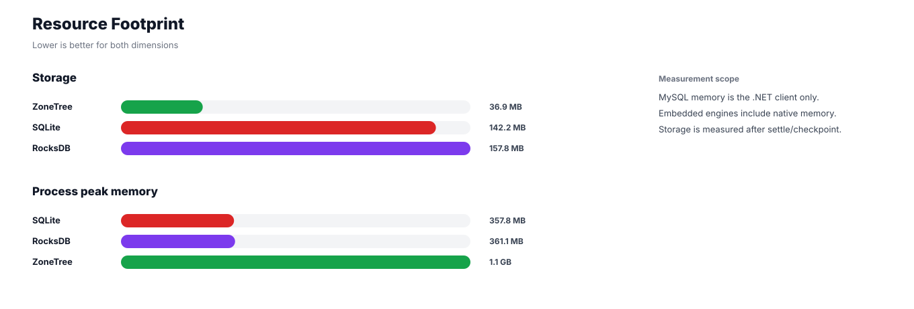

# Benchmark 500K Profiles - Windows

## Charts

### Execution Time

### Write Throughput

### Lookup Throughput

### Index Scan Throughput

### Query Throughput

### Resource Footprint

## Total By Engine

| Engine | Status | Run time | Completed phase time | Pre-read stabilize | Post-update stabilize | Settle | Reopen | Verify | Storage | Process peak memory | Final checksum |
| --- | --- | ---: | ---: | ---: | ---: | ---: | ---: | ---: | ---: | ---: | --- |
| ZoneTree | Completed | 22_161 ms | 20_755 ms | 555 ms | 526 ms | 13 ms | 86 ms | 12 ms | 36.9 MB | 1.1 GB | `DF2D9443B36E4083` |
| RocksDB | Completed | 67_970 ms | 66_026 ms | 567 ms | 972 ms | 1 ms | 45 ms | 75 ms | 157.8 MB | 361.1 MB | `DF2D9443B36E4083` |
| SQLite | Completed | 191_231 ms | 191_070 ms | n/a | n/a | 19 ms | 1 ms | 35 ms | 142.2 MB | 357.8 MB | `DF2D9443B36E4083` |

## Correctness

Checksum validation passed across completed engines: ZoneTree, RocksDB, SQLite.

## Interpretation Notes

* This benchmark measures live single-operation profile inserts, updates, reads, and indexed queries.
* ZoneTree and RocksDB secondary indexes are maintained by the benchmark application using separate stores.
* SQLite maintains secondary indexes inside the database engine.
* Embedded engines run in the benchmark process.
* Completed phase time is the sum of measured workload phases. Run time also includes initialization, stabilization, settle/checkpoint, reopen, verification, and reporting overhead.
* The write throughput chart includes raw write phases and derived write-readiness bars that add the following stabilization phase.
* Storage is measured after each engine settles or checkpoints its data.
* Process peak memory is measured for the benchmark process.

## Write Readiness

| Engine | Insert | Pre-read stabilize | Insert + stabilize | Insert ready throughput | Update | Post-update stabilize | Update + stabilize | Update ready throughput |
| --- | ---: | ---: | ---: | ---: | ---: | ---: | ---: | ---: |
| ZoneTree | 4_140 ms | 555 ms | 4_695 ms | 106_486/s | 2_475 ms | 526 ms | 3_001 ms | 166_598/s |
| RocksDB | 4_851 ms | 567 ms | 5_418 ms | 92_284/s | 10_281 ms | 972 ms | 11_252 ms | 44_435/s |
| SQLite | 60_524 ms | n/a | 60_524 ms | 8_261/s | 75_487 ms | n/a | 75_487 ms | 6_624/s |

## Phase Results

### ZoneTree

| Phase | Operations | Time | Throughput | Checksum |
| --- | ---: | ---: | ---: | --- |
| insert profiles | 500_000 | 4_140 ms | 120_772/s | `B11DAA52EA85C1C5` |
| read by user id | 500_000 | 334 ms | 1_498_844/s | `C99FB8E32773191A` |
| lookup by email | 500_000 | 767 ms | 651_952/s | `706F2D03429A82A7` |
| scan country/status index | 125_000 | 292 ms | 428_410/s | `8E356BA871BD7F8C` |
| query country/status | 125_000 | 2_108 ms | 59_300/s | `278730BE6AF6228A` |
| scan created-at index | 125_000 | 678 ms | 184_433/s | `B5DDE0691514B8AD` |
| query created-at range | 125_000 | 2_732 ms | 45_761/s | `A688AA86490F2738` |
| scan top reputation index | 125_000 | 189 ms | 662_070/s | `540603A72FECF405` |
| query top reputation | 125_000 | 1_758 ms | 71_099/s | `5921287764708505` |
| update profiles | 500_000 | 2_475 ms | 202_027/s | `6AB28B68BED1A31E` |
| post-update read by user id | 500_000 | 316 ms | 1_580_297/s | `C372C9201718339D` |
| post-update lookup by email | 500_000 | 733 ms | 681_969/s | `EBA2EFF100A143BD` |
| post-update scan country/status index | 125_000 | 276 ms | 452_838/s | `A315FF71BC274C9E` |
| post-update query country/status | 125_000 | 2_174 ms | 57_493/s | `DA7DC60B48D60B33` |
| post-update scan top reputation index | 125_000 | 183 ms | 682_428/s | `7242B60DCFE2F6E5` |
| post-update query top reputation | 125_000 | 1_601 ms | 78_075/s | `34B1375F7919D3C5` |

### RocksDB

| Phase | Operations | Time | Throughput | Checksum |
| --- | ---: | ---: | ---: | --- |
| insert profiles | 500_000 | 4_851 ms | 103_081/s | `B11DAA52EA85C1C5` |
| read by user id | 500_000 | 2_144 ms | 233_256/s | `C99FB8E32773191A` |
| lookup by email | 500_000 | 3_864 ms | 129_394/s | `706F2D03429A82A7` |
| scan country/status index | 125_000 | 821 ms | 152_186/s | `8E356BA871BD7F8C` |
| query country/status | 125_000 | 7_000 ms | 17_858/s | `278730BE6AF6228A` |
| scan created-at index | 125_000 | 1_323 ms | 94_466/s | `B5DDE0691514B8AD` |
| query created-at range | 125_000 | 8_187 ms | 15_268/s | `A688AA86490F2738` |
| scan top reputation index | 125_000 | 654 ms | 191_137/s | `540603A72FECF405` |
| query top reputation | 125_000 | 6_217 ms | 20_107/s | `5921287764708505` |
| update profiles | 500_000 | 10_281 ms | 48_636/s | `6AB28B68BED1A31E` |
| post-update read by user id | 500_000 | 2_153 ms | 232_198/s | `C372C9201718339D` |
| post-update lookup by email | 500_000 | 3_888 ms | 128_601/s | `EBA2EFF100A143BD` |
| post-update scan country/status index | 125_000 | 793 ms | 157_599/s | `A315FF71BC274C9E` |
| post-update query country/status | 125_000 | 6_858 ms | 18_226/s | `DA7DC60B48D60B33` |
| post-update scan top reputation index | 125_000 | 648 ms | 192_890/s | `7242B60DCFE2F6E5` |
| post-update query top reputation | 125_000 | 6_344 ms | 19_703/s | `34B1375F7919D3C5` |

### SQLite

| Phase | Operations | Time | Throughput | Checksum |
| --- | ---: | ---: | ---: | --- |
| insert profiles | 500_000 | 60_524 ms | 8_261/s | `B11DAA52EA85C1C5` |
| read by user id | 500_000 | 1_480 ms | 337_831/s | `C99FB8E32773191A` |
| lookup by email | 500_000 | 1_992 ms | 251_018/s | `706F2D03429A82A7` |
| scan country/status index | 125_000 | 1_543 ms | 81_013/s | `8E356BA871BD7F8C` |
| query country/status | 125_000 | 8_374 ms | 14_927/s | `278730BE6AF6228A` |
| scan created-at index | 125_000 | 1_551 ms | 80_602/s | `B5DDE0691514B8AD` |
| query created-at range | 125_000 | 7_853 ms | 15_918/s | `A688AA86490F2738` |
| scan top reputation index | 125_000 | 1_308 ms | 95_571/s | `540603A72FECF405` |
| query top reputation | 125_000 | 7_991 ms | 15_642/s | `5921287764708505` |
| update profiles | 500_000 | 75_487 ms | 6_624/s | `6AB28B68BED1A31E` |
| post-update read by user id | 500_000 | 1_454 ms | 343_937/s | `C372C9201718339D` |
| post-update lookup by email | 500_000 | 1_962 ms | 254_867/s | `EBA2EFF100A143BD` |
| post-update scan country/status index | 125_000 | 1_570 ms | 79_631/s | `A315FF71BC274C9E` |
| post-update query country/status | 125_000 | 8_559 ms | 14_605/s | `DA7DC60B48D60B33` |
| post-update scan top reputation index | 125_000 | 1_320 ms | 94_667/s | `7242B60DCFE2F6E5` |
| post-update query top reputation | 125_000 | 8_102 ms | 15_428/s | `34B1375F7919D3C5` |

## Configuration

* Profiles: 500_000
* Parallelism: 1
* Profile writes: individual operations
* UserId reads: 500_000
* Email lookups: 500_000
* Query count: 125_000
* Profile updates: 500_000
* Post-update UserId reads: 500_000
* Post-update email lookups: 500_000
* Post-update query count: 125_000
* Query limit: 50
* Seed: 570123434
* Timeout: disabled

## Environment

* OS: Microsoft Windows 10.0.26200
* Architecture: X64
* .NET: 10.0.6
* CPU: Intel(R) Core(TM) Ultra 7 265KF
* Logical processors: 20
* Total available memory: 63.6 GB
* Initial process working set: 110.3 MB
* Benchmark version: 1.0.0.0
* ZoneTree version: 2.0.4.0
* Microsoft.Data.Sqlite version: 10.0.0
* SQLite runtime version: 3.50.3
* SQLitePCLRaw.core version: 2.1.11
* SQLitePCLRaw.lib.e_sqlite3 version: 3.50.3
* RocksDbSharp version: 6.2.2
* RocksDbNative version: 6.2.2
* MySqlConnector version: 2.4.0

## Engine Settings

### ZoneTree

* MutableSegmentMaxItemCount: 250000
* SparseArrayStepSize: 16
* KeyCacheSize: 1024
* ValueCacheSize: 1024
* IteratorPrefetchSize: 16
* BlockCacheLifeTime: 1 minutes
* BottomMergePolicy: Full bottom merge when bottom segment count exceeds 1
* ReadStabilization: Settle before read/query phases

### RocksDB

* Databases: profiles,email-index,country-status-index,created-at-index,reputation-index
* Compression: Zstd
* WriteBufferMb: 1024
* MaxWriteBufferNumber: 4
* WriteSync: false
* ReadStabilization: Compact before read/query phases

### SQLite

* JournalMode: WAL
* Synchronous: NORMAL
* CacheMb: 1024
* MmapMb: 1024
* TempStore: MEMORY

## Durability Settings

* ZoneTree: AsyncCompressed WAL default; MutableSegmentMaxItemCount=250000; SparseArrayStepSize=16; KeyCacheSize=1024; ValueCacheSize=1024; IteratorPrefetchSize=16; BlockCacheLifeTime=1 minutes; application-managed secondary indexes; background maintainers enabled.
* RocksDB: WAL enabled; five separate RocksDB instances; no WriteBatch across indexes; compression=Zstd; write_buffer_size=1024 MB per database; max_write_buffer_number=4.
* SQLite: WAL journal mode; synchronous=NORMAL; cache=1024 MB; mmap=1024 MB; native SQL indexes; single-row writes use autocommit.
