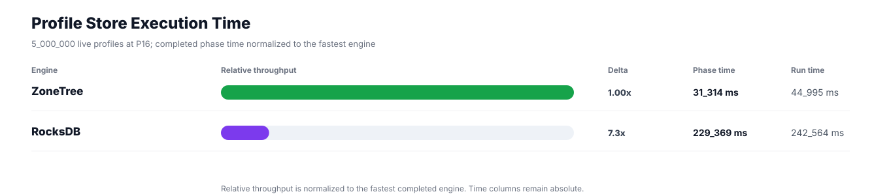
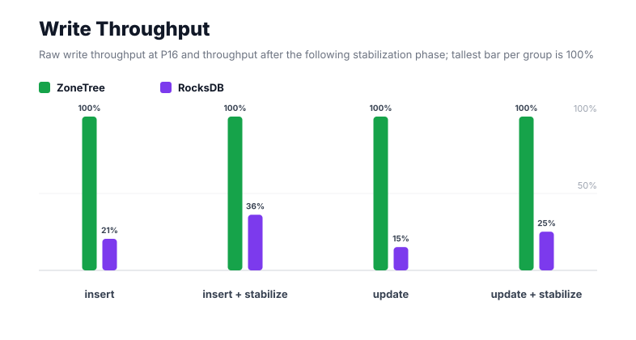
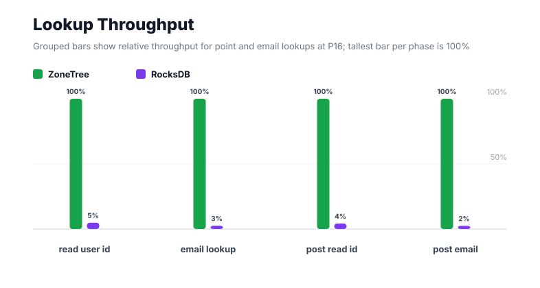
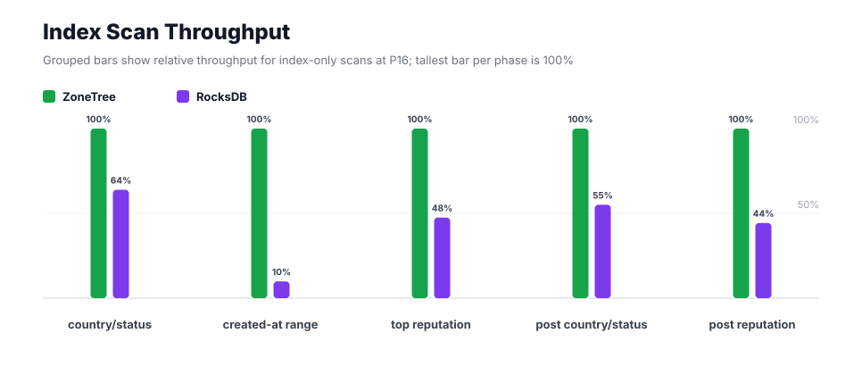
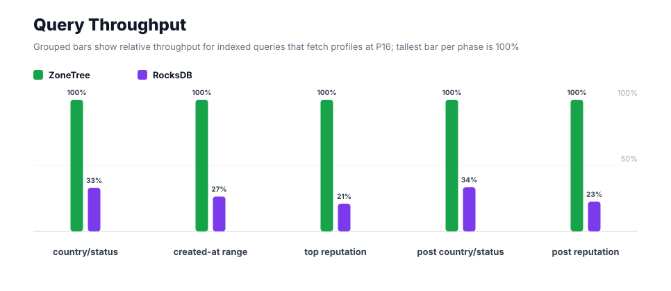
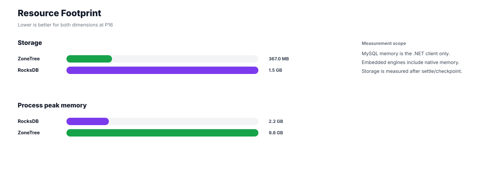

# Benchmark 5M Profiles / P16 - Windows

## Charts

### Execution Time

### Write Throughput

### Lookup Throughput

### Index Scan Throughput

### Query Throughput

### Resource Footprint

## Total By Engine

| Engine | Status | Run time | Completed phase time | Pre-read stabilize | Post-update stabilize | Settle | Reopen | Verify | Storage | Process peak memory | Final checksum |
| --- | --- | ---: | ---: | ---: | ---: | ---: | ---: | ---: | ---: | ---: | --- |
| ZoneTree | Completed | 44_995 ms | 31_314 ms | 6_559 ms | 6_444 ms | 14 ms | 365 ms | 13 ms | 367.0 MB | 9.8 GB | `46D8A7E801AF2C78` |
| RocksDB | Completed | 242_564 ms | 229_369 ms | 5_823 ms | 6_072 ms | 1 ms | 104 ms | 741 ms | 1.5 GB | 2.2 GB | `46D8A7E801AF2C78` |

## Correctness

Checksum validation passed across completed engines: ZoneTree, RocksDB.

## Interpretation Notes

* This benchmark measures live single-operation profile inserts, updates, reads, and indexed queries.
* ZoneTree and RocksDB secondary indexes are maintained by the benchmark application using separate stores.
* Embedded engines run in the benchmark process.
* Completed phase time is the sum of measured workload phases. Run time also includes initialization, stabilization, settle/checkpoint, reopen, verification, and reporting overhead.
* The write throughput chart includes raw write phases and derived write-readiness bars that add the following stabilization phase.
* Storage is measured after each engine settles or checkpoints its data.
* Process peak memory is measured for the benchmark process.

## Write Readiness

| Engine | Insert | Pre-read stabilize | Insert + stabilize | Insert ready throughput | Update | Post-update stabilize | Update + stabilize | Update ready throughput |
| --- | ---: | ---: | ---: | ---: | ---: | ---: | ---: | ---: |
| ZoneTree | 5_835 ms | 6_559 ms | 12_394 ms | 403_426/s | 7_439 ms | 6_444 ms | 13_883 ms | 360_152/s |
| RocksDB | 28_427 ms | 5_823 ms | 34_251 ms | 145_982/s | 49_107 ms | 6_072 ms | 55_178 ms | 90_615/s |

## Phase Results

### ZoneTree

| Phase | Operations | Time | Throughput | Checksum |
| --- | ---: | ---: | ---: | --- |
| insert profiles | 5_000_000 | 5_835 ms | 856_961/s | `A9B2B7203E9651E7` |
| read by user id | 5_000_000 | 387 ms | 12_911_976/s | `1D1E5DD4C5A178CD` |
| lookup by email | 5_000_000 | 926 ms | 5_397_702/s | `396156D83FB49B40` |
| scan country/status index | 1_250_000 | 461 ms | 2_711_908/s | `B7BD2D152F1AFFE1` |
| query country/status | 1_250_000 | 2_493 ms | 501_390/s | `A1DE293574C06D66` |
| scan created-at index | 1_250_000 | 1_217 ms | 1_027_341/s | `F90B4F28382222C9` |
| query created-at range | 1_250_000 | 4_034 ms | 309_889/s | `2594FE6637C9CC2A` |
| scan top reputation index | 1_250_000 | 402 ms | 3_110_521/s | `998AC961090B0585` |
| query top reputation | 1_250_000 | 1_716 ms | 728_239/s | `A09380754DCE86A5` |
| update profiles | 5_000_000 | 7_439 ms | 672_157/s | `2A5E0D2A49A10A67` |
| post-update read by user id | 5_000_000 | 339 ms | 14_767_144/s | `E7459C3F8BC27513` |
| post-update lookup by email | 5_000_000 | 911 ms | 5_487_281/s | `01FFB666E8034783` |
| post-update scan country/status index | 1_250_000 | 420 ms | 2_977_736/s | `90A88BB781FB061D` |
| post-update query country/status | 1_250_000 | 2_577 ms | 485_045/s | `2BF4FDDC318767FC` |
| post-update scan top reputation index | 1_250_000 | 392 ms | 3_185_967/s | `884C15620C602745` |
| post-update query top reputation | 1_250_000 | 1_765 ms | 708_045/s | `36BFEEF3B7B7E4C5` |

### RocksDB

| Phase | Operations | Time | Throughput | Checksum |
| --- | ---: | ---: | ---: | --- |
| insert profiles | 5_000_000 | 28_427 ms | 175_886/s | `A9B2B7203E9651E7` |
| read by user id | 5_000_000 | 8_016 ms | 623_714/s | `1D1E5DD4C5A178CD` |
| lookup by email | 5_000_000 | 36_818 ms | 135_804/s | `396156D83FB49B40` |
| scan country/status index | 1_250_000 | 721 ms | 1_733_395/s | `B7BD2D152F1AFFE1` |
| query country/status | 1_250_000 | 7_518 ms | 166_278/s | `A1DE293574C06D66` |
| scan created-at index | 1_250_000 | 12_279 ms | 101_799/s | `F90B4F28382222C9` |
| query created-at range | 1_250_000 | 15_199 ms | 82_244/s | `2594FE6637C9CC2A` |
| scan top reputation index | 1_250_000 | 845 ms | 1_478_903/s | `998AC961090B0585` |
| query top reputation | 1_250_000 | 8_146 ms | 153_454/s | `A09380754DCE86A5` |
| update profiles | 5_000_000 | 49_107 ms | 101_819/s | `2A5E0D2A49A10A67` |
| post-update read by user id | 5_000_000 | 8_019 ms | 623_551/s | `E7459C3F8BC27513` |
| post-update lookup by email | 5_000_000 | 37_157 ms | 134_565/s | `01FFB666E8034783` |
| post-update scan country/status index | 1_250_000 | 762 ms | 1_640_121/s | `90A88BB781FB061D` |
| post-update query country/status | 1_250_000 | 7_679 ms | 162_790/s | `2BF4FDDC318767FC` |
| post-update scan top reputation index | 1_250_000 | 885 ms | 1_412_475/s | `884C15620C602745` |
| post-update query top reputation | 1_250_000 | 7_792 ms | 160_430/s | `36BFEEF3B7B7E4C5` |

## Configuration

* Profiles: 5_000_000
* Parallelism: 16
* Profile writes: individual operations
* UserId reads: 5_000_000
* Email lookups: 5_000_000
* Query count: 1_250_000
* Profile updates: 5_000_000
* Post-update UserId reads: 5_000_000
* Post-update email lookups: 5_000_000
* Post-update query count: 1_250_000
* Query limit: 50
* Seed: 570123434
* Timeout: disabled

## Environment

* OS: Microsoft Windows 10.0.26200
* Architecture: X64
* .NET: 10.0.6
* CPU: Intel(R) Core(TM) Ultra 7 265KF
* Logical processors: 20
* Total available memory: 63.6 GB
* Initial process working set: 417.5 MB
* Benchmark version: 1.0.0.0
* ZoneTree version: 2.0.4.0
* Microsoft.Data.Sqlite version: 10.0.0
* SQLite runtime version: 3.50.3
* SQLitePCLRaw.core version: 2.1.11
* SQLitePCLRaw.lib.e_sqlite3 version: 3.50.3
* RocksDbSharp version: 6.2.2
* RocksDbNative version: 6.2.2
* MySqlConnector version: 2.4.0

## Engine Settings

### ZoneTree

* MutableSegmentMaxItemCount: 250000
* SparseArrayStepSize: 16
* KeyCacheSize: 1024
* ValueCacheSize: 1024
* IteratorPrefetchSize: 16
* BlockCacheLifeTime: 1 minutes
* BottomMergePolicy: Full bottom merge when bottom segment count exceeds 1
* ReadStabilization: Settle before read/query phases

### RocksDB

* Databases: profiles,email-index,country-status-index,created-at-index,reputation-index
* Compression: Zstd
* WriteBufferMb: 1024
* MaxWriteBufferNumber: 4
* WriteSync: false
* ReadStabilization: Compact before read/query phases

## Durability Settings

* ZoneTree: AsyncCompressed WAL default; MutableSegmentMaxItemCount=250000; SparseArrayStepSize=16; KeyCacheSize=1024; ValueCacheSize=1024; IteratorPrefetchSize=16; BlockCacheLifeTime=1 minutes; application-managed secondary indexes; background maintainers enabled.
* RocksDB: WAL enabled; five separate RocksDB instances; no WriteBatch across indexes; compression=Zstd; write_buffer_size=1024 MB per database; max_write_buffer_number=4.
