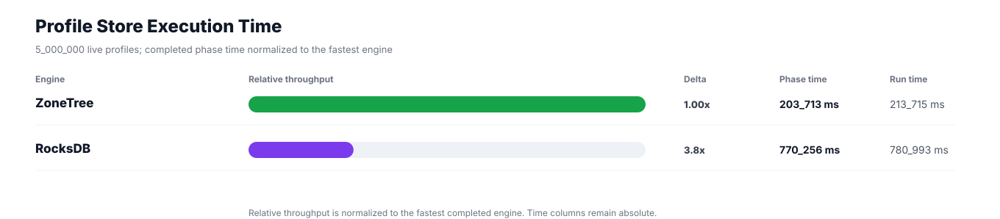
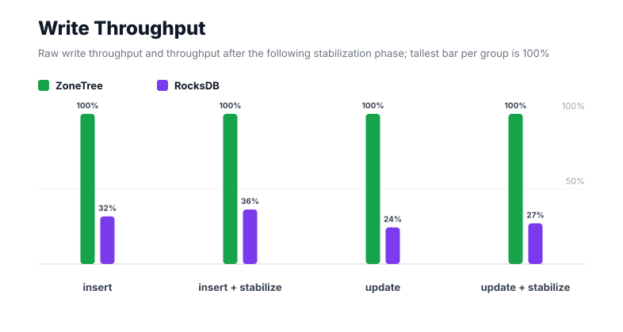
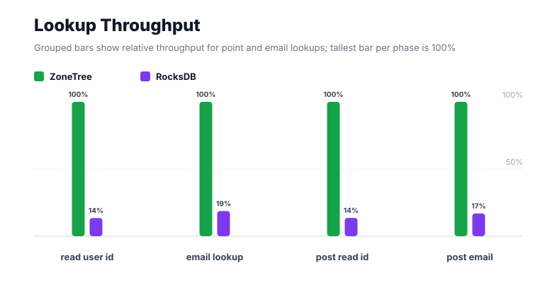
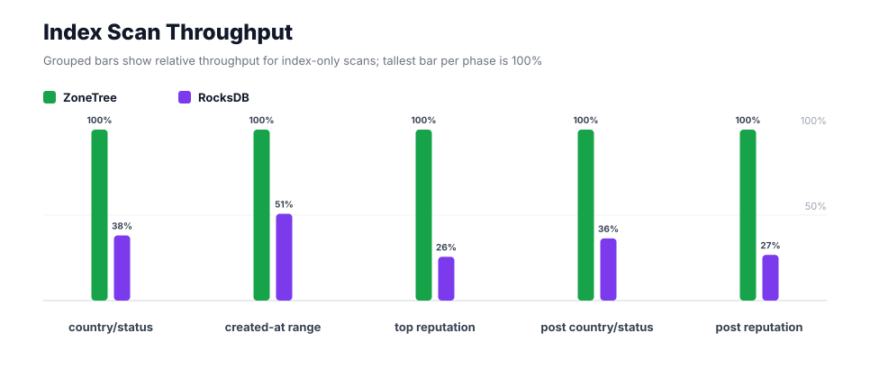
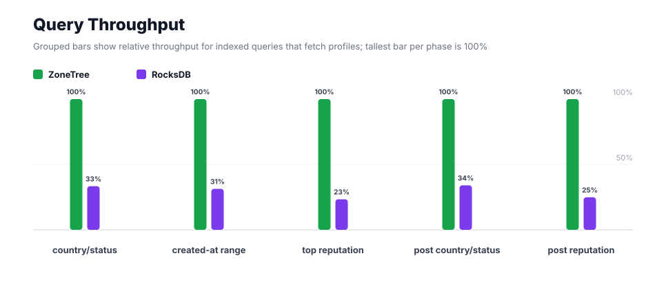
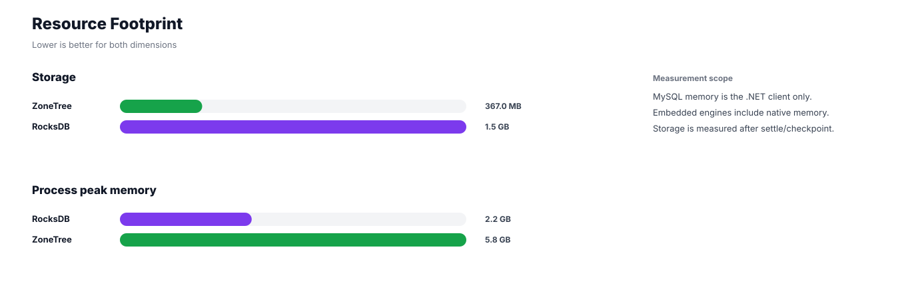

# Benchmark 5M Profiles - Windows

## Charts

### Execution Time

### Write Throughput

### Lookup Throughput

### Index Scan Throughput

### Query Throughput

### Resource Footprint

## Total By Engine

| Engine | Status | Run time | Completed phase time | Pre-read stabilize | Post-update stabilize | Settle | Reopen | Verify | Storage | Process peak memory | Final checksum |
| --- | --- | ---: | ---: | ---: | ---: | ---: | ---: | ---: | ---: | ---: | --- |
| ZoneTree | Completed | 213_715 ms | 203_713 ms | 3_886 ms | 5_488 ms | 14 ms | 290 ms | 13 ms | 367.0 MB | 5.8 GB | `46D8A7E801AF2C78` |
| RocksDB | Completed | 780_993 ms | 770_256 ms | 3_858 ms | 5_729 ms | 1 ms | 47 ms | 730 ms | 1.5 GB | 2.2 GB | `46D8A7E801AF2C78` |

## Correctness

Checksum validation passed across completed engines: ZoneTree, RocksDB.

## Interpretation Notes

* This benchmark measures live single-operation profile inserts, updates, reads, and indexed queries.
* ZoneTree and RocksDB secondary indexes are maintained by the benchmark application using separate stores.
* Embedded engines run in the benchmark process.
* Completed phase time is the sum of measured workload phases. Run time also includes initialization, stabilization, settle/checkpoint, reopen, verification, and reporting overhead.
* The write throughput chart includes raw write phases and derived write-readiness bars that add the following stabilization phase.
* Storage is measured after each engine settles or checkpoints its data.
* Process peak memory is measured for the benchmark process.

## Write Readiness

| Engine | Insert | Pre-read stabilize | Insert + stabilize | Insert ready throughput | Update | Post-update stabilize | Update + stabilize | Update ready throughput |
| --- | ---: | ---: | ---: | ---: | ---: | ---: | ---: | ---: |
| ZoneTree | 17_097 ms | 3_886 ms | 20_983 ms | 238_289/s | 35_312 ms | 5_488 ms | 40_800 ms | 122_549/s |
| RocksDB | 53_922 ms | 3_858 ms | 57_781 ms | 86_534/s | 144_843 ms | 5_729 ms | 150_571 ms | 33_207/s |

## Phase Results

### ZoneTree

| Phase | Operations | Time | Throughput | Checksum |
| --- | ---: | ---: | ---: | --- |
| insert profiles | 5_000_000 | 17_097 ms | 292_452/s | `1CE7E98CB02A5BE5` |
| read by user id | 5_000_000 | 3_524 ms | 1_418_929/s | `AEA5A1780B272814` |
| lookup by email | 5_000_000 | 10_171 ms | 491_617/s | `8C938BAD6D81DE32` |
| scan country/status index | 1_250_000 | 3_034 ms | 412_049/s | `B79C7B37665D1476` |
| query country/status | 1_250_000 | 22_122 ms | 56_506/s | `6CA0BA910B744D18` |
| scan created-at index | 1_250_000 | 8_068 ms | 154_930/s | `8DC6BE6EDE720671` |
| query created-at range | 1_250_000 | 27_667 ms | 45_179/s | `161BAEF279779E37` |
| scan top reputation index | 1_250_000 | 1_782 ms | 701_300/s | `8EABE473965ABDA5` |
| query top reputation | 1_250_000 | 14_988 ms | 83_399/s | `239CAFF01A8FE9A5` |
| update profiles | 5_000_000 | 35_312 ms | 141_596/s | `AD890A8797F25027` |
| post-update read by user id | 5_000_000 | 3_582 ms | 1_396_001/s | `537ED4CF9543514D` |
| post-update lookup by email | 5_000_000 | 10_154 ms | 492_414/s | `F71390337A010BCF` |
| post-update scan country/status index | 1_250_000 | 2_924 ms | 427_440/s | `455D3F66E87CBCD7` |
| post-update query country/status | 1_250_000 | 24_305 ms | 51_430/s | `8B4F4083259744A8` |
| post-update scan top reputation index | 1_250_000 | 1_883 ms | 663_985/s | `0A945E5B0B54D925` |
| post-update query top reputation | 1_250_000 | 17_101 ms | 73_097/s | `53DA4C62CB40A725` |

### RocksDB

| Phase | Operations | Time | Throughput | Checksum |
| --- | ---: | ---: | ---: | --- |
| insert profiles | 5_000_000 | 53_922 ms | 92_726/s | `1CE7E98CB02A5BE5` |
| read by user id | 5_000_000 | 26_046 ms | 191_966/s | `AEA5A1780B272814` |
| lookup by email | 5_000_000 | 54_370 ms | 91_963/s | `8C938BAD6D81DE32` |
| scan country/status index | 1_250_000 | 7_963 ms | 156_970/s | `B79C7B37665D1476` |
| query country/status | 1_250_000 | 66_305 ms | 18_852/s | `6CA0BA910B744D18` |
| scan created-at index | 1_250_000 | 15_889 ms | 78_671/s | `8DC6BE6EDE720671` |
| query created-at range | 1_250_000 | 88_279 ms | 14_160/s | `161BAEF279779E37` |
| scan top reputation index | 1_250_000 | 6_959 ms | 179_614/s | `8EABE473965ABDA5` |
| query top reputation | 1_250_000 | 64_103 ms | 19_500/s | `239CAFF01A8FE9A5` |
| update profiles | 5_000_000 | 144_843 ms | 34_520/s | `AD890A8797F25027` |
| post-update read by user id | 5_000_000 | 26_287 ms | 190_208/s | `537ED4CF9543514D` |
| post-update lookup by email | 5_000_000 | 60_003 ms | 83_329/s | `F71390337A010BCF` |
| post-update scan country/status index | 1_250_000 | 8_037 ms | 155_531/s | `455D3F66E87CBCD7` |
| post-update query country/status | 1_250_000 | 71_435 ms | 17_498/s | `8B4F4083259744A8` |
| post-update scan top reputation index | 1_250_000 | 7_044 ms | 177_452/s | `0A945E5B0B54D925` |
| post-update query top reputation | 1_250_000 | 68_769 ms | 18_177/s | `53DA4C62CB40A725` |

## Configuration

* Profiles: 5_000_000
* Parallelism: 1
* Profile writes: individual operations
* UserId reads: 5_000_000
* Email lookups: 5_000_000
* Query count: 1_250_000
* Profile updates: 5_000_000
* Post-update UserId reads: 5_000_000
* Post-update email lookups: 5_000_000
* Post-update query count: 1_250_000
* Query limit: 50
* Seed: 570123434
* Timeout: disabled

## Environment

* OS: Microsoft Windows 10.0.26200
* Architecture: X64
* .NET: 10.0.6
* CPU: Intel(R) Core(TM) Ultra 7 265KF
* Logical processors: 20
* Total available memory: 63.6 GB
* Initial process working set: 424.3 MB
* Benchmark version: 1.0.0.0
* ZoneTree version: 2.0.4.0
* Microsoft.Data.Sqlite version: 10.0.0
* SQLite runtime version: 3.50.3
* SQLitePCLRaw.core version: 2.1.11
* SQLitePCLRaw.lib.e_sqlite3 version: 3.50.3
* RocksDbSharp version: 6.2.2
* RocksDbNative version: 6.2.2
* MySqlConnector version: 2.4.0

## Engine Settings

### ZoneTree

* MutableSegmentMaxItemCount: 250000
* SparseArrayStepSize: 16
* KeyCacheSize: 1024
* ValueCacheSize: 1024
* IteratorPrefetchSize: 16
* BlockCacheLifeTime: 1 minutes
* BottomMergePolicy: Full bottom merge when bottom segment count exceeds 1
* ReadStabilization: Settle before read/query phases

### RocksDB

* Databases: profiles,email-index,country-status-index,created-at-index,reputation-index
* Compression: Zstd
* WriteBufferMb: 1024
* MaxWriteBufferNumber: 4
* WriteSync: false
* ReadStabilization: Compact before read/query phases

## Durability Settings

* ZoneTree: AsyncCompressed WAL default; MutableSegmentMaxItemCount=250000; SparseArrayStepSize=16; KeyCacheSize=1024; ValueCacheSize=1024; IteratorPrefetchSize=16; BlockCacheLifeTime=1 minutes; application-managed secondary indexes; background maintainers enabled.
* RocksDB: WAL enabled; five separate RocksDB instances; no WriteBatch across indexes; compression=Zstd; write_buffer_size=1024 MB per database; max_write_buffer_number=4.
